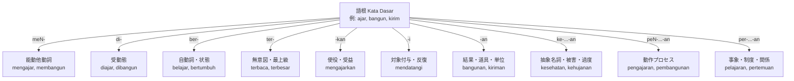

# 周囲辞 peN-...-an と per-...-an の動作過程・行為・結果の比較

インドネシア語のビジネス文書、新聞・ニュース、公的報告書を読んでいると、**peN-...-an** や **per-...-an** で終わる重厚な名詞に無数に出会います。

どちらも語根を挟み込んで名詞を作る周囲辞ですが、両者には「**動作のプロセス（過程・実行）**」と「**事象・関係・制度・結果**」という明確な役割分担があります。

この2つの周囲辞の根本原理を掴むと、高度なインドネシア語の文章が一気にクリアに読み解けるようになります。

---

## 1. 2大周囲辞の基本法則と対応関係

`peN-...-an` と `per-...-an` の決定的な違いは、「**どの動詞・品詞とペアになっているか**」にあります。

```text
【peN-...-an の世界】: meN- 動詞（他動詞・意図的動作）と連動
語根: tulis (書く)   → 動詞: menulis (書く)         → 名詞: penulisan (執筆のプロセス・作業)
語根: bangun (建てる) → 動詞: membangun (建設する)    → 名詞: pembangunan (建設工事・開発事業)

【per-...-an の世界】: ber- 動詞（自動詞・相互関係）や名詞・形容詞と連動
語根: temu (会う)    → 動詞: bertemu (会う・対面する) → 名詞: pertemuan (会合・ミーティング)
語根: beda (違う)    → 動詞: berbeda (異なる)        → 名詞: perbedaan (相違点・違い)
```

| 項目 | 周囲辞 peN-...-an | 周囲辞 per-...-an |
|---|---|---|
| **対応する動詞** | **meN-**（意図的な動作・他動詞） | **ber-**（自動詞・相互行為）や名詞 |
| **中心的な意味** | **動作のプロセス・過程・実行手続き** | **事象・結果・相互関係・制度・場所** |
| **音変化** | 接頭辞 peN- と同様（K, T, S, P 鼻音化） | r の重複・隣接による脱落（pe-...-an） |
| **代表例** | pengembangan, pembayaran, pengiriman | perkembangan, pertemuan, perbedaan |

---

## 2. 周囲辞 peN-...-an：動作のプロセスと実行

`peN-...-an` は、「**〜すること**」「**〜という作業・実行手続き・過程**」を表します。

### 音変化の規則（接頭辞 peN- と同一）
語根の最初の文字によって、`pem-...-an`, `pen-...-an`, `peny-...-an`, `peng-...-an`, `penge-...-an` に変化します（K, T, S, P は脱落して鼻音化）。

- **bayar**（支払う） $\rightarrow$ **pembayaran**（支払い・決済手続き）
- **didik**（教育する） $\rightarrow$ **pendidikan**（教育・教育活動）
- **selesai**（終わる） $\rightarrow$ **penyelesaian**（解決・完了プロセス）
- **kembang**（広げる） $\rightarrow$ **pengembangan**（開発・育成・開拓事業）
- **catat**（記録する） $\rightarrow$ **pencatatan**（記録作業・記帳）

<div class="id-example">
<div class="id-sentence">Proses pembayaran dapat dilakukan melalui transfer bank atau kartu kredit.</div>
<div class="id-translation">支払い手続きは銀行振込またはクレジットカードで行うことができます。</div>
<div class="id-explanation">bayar（支払う）→ pembayaran（支払いプロセス・決済）。</div>
</div>

<div class="id-example">
<div class="id-sentence">Perusahaan kami sedang fokus pada pengembangan produk baru.</div>
<div class="id-translation">当社は現在、新製品の開発（プロセス）に注力しています。</div>
<div class="id-explanation">kembangkan（発展させる）→ pengembangan（開発事業・発展の取り組み）。</div>
</div>

---

## 3. 周囲辞 per-...-an：事象・関係・制度・結果

`per-...-an` は、動作の実行そのものではなく、「**人と人との関係**」「**会議・事象**」「**場所**」「**制度・組織**」「**結果として生じた状態**」を表します。

### 音変化の規則（r の脱落）
語根の頭が `r` の場合、または語根の第1音節に `-er-` を含む場合、`r` が脱落して **pe-...-an** になります。

- **kerja**（働く） $\rightarrow$ **pekerjaan**（仕事・職種・雇用）
- **ajar**（教える/学ぶ） $\rightarrow$ **pelajaran**（教科・学科・レッスン）
- **temu**（会う） $\rightarrow$ **pertemuan**（会合・打ち合わせ）
- **syarat**（条件） $\rightarrow$ **persyaratan**（要件・条件項目）
- **jodoh**（縁） $\rightarrow$ **perjodohan**（縁談・見合い）
- **henti**（止まる） $\rightarrow$ **perhentian**（停留所・停車場）
- **hotel**（ホテル） $\rightarrow$ **perhotelan**（ホテル業界・ホテル業全般）

<div class="id-example">
<div class="id-sentence">Pertemuan bisnis akan diadakan di ruang rapat lantai dua.</div>
<div class="id-translation">商談（ミーティング）は2階の会議室で開催されます。</div>
<div class="id-explanation">bertemu（会う）→ pertemuan（会合・打ち合わせ・イベント）。</div>
</div>

<div class="id-example">
<div class="id-sentence">Apakah ada perbedaan besar antara kedua produk ini?</div>
<div class="id-translation">これら2つの製品の間に大きな違い（相違点）はありますか？</div>
<div class="id-explanation">berbeda（異なる）→ perbedaan（違い・相違点という概念/結果）。</div>
</div>

---

## 4. 同一語根での徹底対比（最重要！）

同じ語根に `peN-...-an` と `per-...-an` の両方が付く場合、意味の対比が鮮やかに現れます。試験や実務で差がつくポイントです。

### 対比①：ajar（教える / 学ぶ）
```text
pengajaran：教えるプロセス・教授法・教育指導
pelajaran ：教わる内容・学科・教科・人生の教訓
```
<div class="id-example">
<div class="id-sentence">Metode pengajaran guru itu sangat menarik bagi siswa.</div>
<div class="id-translation">その先生の教授法（教える行為・アプローチ）は生徒たちにとって非常に興味深いです。</div>
</div>
<div class="id-example">
<div class="id-sentence">Pelajaran matematika hari ini cukup sulit.</div>
<div class="id-translation">今日の数学の授業（科目・レッスン内容）はかなり難しかったです。</div>
</div>

### 対比②：kembang（広がる / 広げる）
```text
pengembangan：人間が意図的に行う「開発・育成・開拓事業」（mengembangkan と連動）
perkembangan：自然な「成長・推移・発展の状況」（berkembang と連動）
```
<div class="id-example">
<div class="id-sentence">Pemerintah memantau perkembangan ekonomi nasional setiap bulan.</div>
<div class="id-translation">政府は国家経済の発展・推移の状況を毎月監視しています。</div>
</div>

### 対比③：ubah（変わる / 変える）
```text
pengubahan：修正・書き換え作業（意図的な変更プロセス）
perubahan ：変化・変容（社会や状況が自然に変わったこと）
```
<div class="id-example">
<div class="id-sentence">Perubahan iklim menjadi tantangan global masa kini.</div>
<div class="id-translation">気候変動（変化という事象そのもの）は現代の地球規模の課題となっています。</div>
</div>

### 対比④：-an / peN-...-an / per-...-an の三つ巴（bangun & kirim）
| 語根 | -an（結果・物） | peN-...-an（動作プロセス） | per-...-an（制度・場所・事象） |
|---|---|---|---|
| **bangun** | **bangunan**（建物・建造物） | **pembangunan**（建設事業・開発作業） | - |
| **kirim** | **kiriman**（届いた小包・荷物） | **pengiriman**（発送業務・配送プロセス） | - |
| **tulis** | **tulisan**（書かれた文章・筆跡） | **penulisan**（執筆作業・書くこと） | - |

---

## 5. 接辞システム（Sistem Imbuhan）全体マップ

ここまで学んだ接頭辞、接尾辞、周囲辞は、すべて語根（Kata Dasar）を中心とする有機的なネットワークを形成しています。



このマップが頭の中にあれば、どんなに長く複雑なインドネシア語の単語に出会っても、まず「語根」を取り出し、前後の接辞を分析することで正確に意味を解読できます。

---

## まとめと練習問題

1. **peN-...-an** は `meN-` 動詞と対をなし、「意図的な動作プロセス・作業手続き」を表す。
2. **per-...-an** は `ber-` 動詞・名詞と対をなし、「事象・制度・相互関係・結果」を表す。
3. `ajar` や `kembang` のように、同一語根の対比（pengajaran vs pelajaran / pengembangan vs perkembangan）を意識すると理解が深まる。

### 理解度チェック
空欄に最も適切な単語（**pengembangan** または **perkembangan**）を選びましょう。

1. Kami sedang melakukan (__________) aplikasi baru untuk smartphone.
   （私たちはスマートフォンのための新しいアプリの開発を行っています。）
2. Dokter anak itu senang melihat (__________) fisik bayi yang sehat.
   （その小児科医は、赤ちゃんの健康な身体的成長・発達を見て喜んだ。）

<details>
<summary>解答と解説</summary>

1. **pengembangan**（人間が意図的に推進するプロジェクト・開発プロセスのため、mengembangkan と連動する pengembangan が適切です。）
2. **perkembangan**（赤ちゃんが自発的・自然に成長・発達する様子のため、berkembang と連動する perkembangan が適切です。）
</details>
