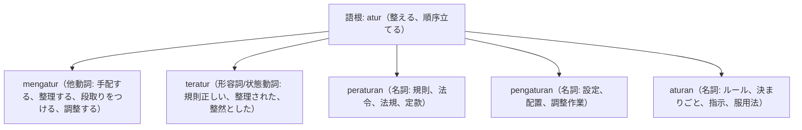

# 語根 atur の全派生語図鑑（mengatur, teratur, peraturan, pengaturan, aturan）

「秩序・規則・手配・段取り」を網羅する統制の重要語根 **atur** の派生語ネットワークです。

---

## 1. 語根 atur からの派生語ファミリー

---

## 2. 各派生語の詳細解説と例文

### ① mengatur（手配する・段取りする）
- 日常・ビジネスの双方で「予定を調整する」「手配する」として頻用されます。

Sekretaris sedang mengatur jadwal pertemuan antara direksi dengan calon investor asing.

秘書は役員と外国人投資家候補との面談日程を調整・手配しています。

mengatur jadwal（スケジュールを調整・手配する） / calon investor asing（外国人投資家候補）。

### ② peraturan（法令・規則） vs teratur（規則正しい）
- **Peraturan Pemerintah (PP)**: 政府令。

Seluruh pegawai wajib mematuhi peraturan keselamatan kerja yang berlaku di area pabrik.

全従業員は、工場敷地内で適用されている労働安全衛生規則を遵守する義務があります。

mematuhi peraturan（規則を遵守する） / keselamatan kerja（労働安全）。

Berolahraga secara teratur dan makan makanan bergizi penting untuk menjaga daya tahan tubuh.

規則正しい運動と栄養ある食事は、体の免疫力（持久力）を維持するために重要です。

secara teratur（規則正しく・定期的に） / daya tahan tubuh（免疫力）。

---

## 3. 理解度チェッククイズ

Q1. スマホやPCの「設定画面（Settings）」のインドネシア語は？

<strong>正解: Pengaturan（Setelan）</strong> 
解説: 調整・セットアップ作業を意味する名詞 pengaturan が使われます。

Q2. 「交通ルール・社内規則」の「規則」を表す代表的単語は？

<strong>正解: peraturan / aturan</strong> 
解説: 法律や公式な規則には peraturan、日常的なルールには aturan が使われます。

