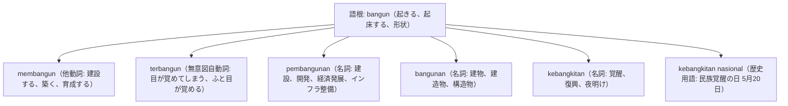

# 語根 bangun の全派生語図鑑（membangun, terbangun, pembangunan, kebangkitan）

「目が覚める、起きる」という身体的覚醒から、「建設する、国家を発展させる」、そして歴史の「民族の覚醒」まで広がる語根 **bangun** の派生語ネットワークです。

---

## 1. 語根 bangun からの派生語ファミリー

---

## 2. 各派生語の詳細解説と例文

### ① membangun（他動詞: 建設する、築き上げる）
- **物理的建設**: *membangun gedung*（ビルを建設する）。
- **抽象的構築**: *membangun kepercayaan*（信頼関係を築く）。

Kedua negara sepakat untuk membangun kemitraan strategis yang lebih kokoh di bidang ekonomi hijau.

両国は、グリーン経済分野においてより強固な戦略的パートナーシップを構築することに合意しました。

membangun kemitraan strategis（戦略的パートナーシップを構築する）。

### ② pembangunan（名詞: 開発、建設、経済発展）
- インドネシア現代史で極めて重きを置かれる言葉（Bapak Pembangunan＝開発の父スハルト）。

Pemerintah memprioritaskan pembangunan infrastruktur transportasi publik ramah lingkungan di Ibu Kota Nusantara (IKN).

政府は、新首都ヌサンタラ（IKN）において環境に配慮した公共交通インフラの開発を優先しています。

pembangunan infrastruktur（インフラ開発） / Ibu Kota Nusantara (IKN: 新首都)。

### ③ terbangun（無意図自動詞: 目が覚めてしまう）

Tadi malam saya tiba-tiba terbangun pada jam tiga dini hari karena mendengar suara petir yang sangat keras.

昨夜、とても大きな雷鳴を聞いて、私は午前3時に突然目が覚めてしまいました。

terbangun（接頭辞 ter- による無意図の覚醒） / dini hari（未明・深夜）。

---

## 3. 理解度チェッククイズ

Q1. 「国家開発、インフラ整備」を意味する重要名詞は？

<strong>正解: pembangunan</strong> 
解説: peN-...-an により「建設・開発するプロセス」を表す重要政策用語です。

Q2. 「意図せずふと目が覚めてしまった」を表す自動詞は？

<strong>正解: terbangun</strong> 
解説: 接頭辞 ter- が自発・偶発を表し、「目が覚める」となります。能動的に起床する場合は bangun tidur です。

