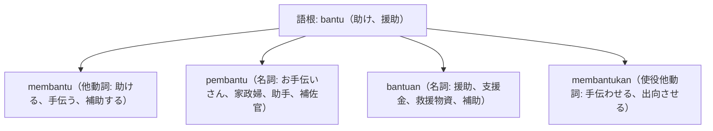

# 語根 bantu の全派生語図鑑（membantu, pembantu, bantuan）

「支援・手助け・救済・補助」を司る互助・協力の基礎語根 **bantu** の派生語ネットワークです。

---

## 1. 語根 bantu からの派生語ファミリー

---

## 2. 各派生語の詳細解説と例文

### ① membantu（他動詞: 助ける） vs bantuan（名詞: 支援物資・救援金）

Relawan dengan sigap membantu proses evakuasi warga korban banjir ke tempat penampungan.

ボランティアたちは、洪水被災者の避難所への避難誘導プロセスを迅速に手伝いました。

dengan sigap（迅速・機敏に） / membantu proses evakuasi（避難活動を手伝う）。

Bantuan kemanusiaan berupa makanan instan dan obat-obatan mulai disalurkan ke desa terpencil.

即席食品や医薬品などの人道支援物資が、孤立した村落への配送を開始されました。

bantuan kemanusiaan（人道支援） / disalurkan（配布・流通される）。

### ② pembantu（お手伝いさん、家政婦、助手）
- インドネシア生活では家事使用人を指す **pembantu rumah tangga (PRT)** または **ART**（Asisten Rumah Tangga）として身近です。

Pemerintah merancang undang-undang khusus untuk melindungi hak-hak pekerja rumah tangga.

政府は、家事労働者の権利を保護するための特別法案を起草しています。

pekerja rumah tangga（家事労働者＝pembantu rumah tanggaの公的呼称）。

---

## 3. 理解度チェッククイズ

Q1. 「人道支援」をインドネシア語で言うと？

<strong>正解: bantuan kemanusiaan</strong> 
解説: 語根 bantu に接尾辞 -an がついた bantuan（支援）＋ kemanusiaan（人道）。

Q2. 「何かお手伝いしましょうか？」の丁寧な接客フレーズは？

<strong>正解: Ada yang bisa saya bantu?</strong> 
解説: 店員や受付の決まり文句です。

