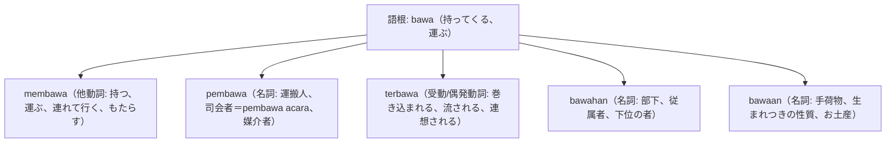

# 語根 bawa の全派生語図鑑（membawa, pembawa, terbawa, bawahan）

「持参・運搬・部下・もたらす」という物理移動と組織階層の重要語根 **bawa** の派生語ネットワークです。

---

## 1. 語根 bawa からの派生語ファミリー

---

## 2. 各派生語の詳細解説と例文

### ① membawa dampak positif（好影響をもたらす）
- 物理的に物を持つだけでなく、「結果や影響をもたらす」という抽象動詞としても最頻出です。

Pembangunan jalan tol trans-Jawa membawa dampak positif yang besar bagi mobilitas logistik nasional.

トランス・ジャワ高速道路の建設は、国家の物流流動性に多大な好影響をもたらしました。

membawa dampak positif（好影響をもたらす） / mobilitas logistik（物流モビリティ）。

### ② pembawa acara（司会者: MC） vs bawahan（部下）

Pembawa acara memandu jalannya seminar internasional dengan bahasa yang sangat lugas dan komunikatif.

司会者（MC）は、非常に簡潔で親しみやすい言葉遣いで国際セミナーの進行を舵取りしました。

pembawa acara（イベント司会者、MC） / memandu jalannya seminar（セミナーの進行を導く）。

Seorang manajer yang baik harus mampu mendengarkan aspirasi dan keluhan dari para bawahannya.

優れたマネージャーは、部下たちの要望（抱負）や悩みに耳を傾けることができなければなりません。

mendengarkan aspirasi（要望に耳を傾ける） / bawahan（部下）。

---

## 3. 理解度チェッククイズ

Q1. イベントやテレビ番組の「司会者（MC）」のインドネシア語は？

<strong>正解: pembawa acara（MC）</strong> 
解説: 行事（acara）を運ぶ人（pembawa）＝司会進行役です。

Q2. 上司（atasan）に対する「部下」を表す単語は？

<strong>正解: bawahan</strong> 
解説: 位置が下（bawah）にある人＝部下を意味します。

