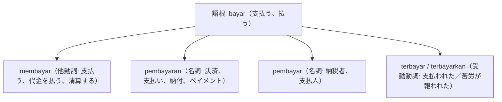

# 語根 bayar の全派生語図鑑（membayar, pembayaran, pembayar, terbayar）

「支払い・決済・清算・報われる」を司る金融・会計・生活の主幹語根 **bayar** の派生語ネットワークです。

---

## 1. 語根 bayar からの派生語ファミリー

---

## 2. 各派生語の詳細解説と例文

### ① pembayaran digital（デジタル決済）
- QRISや電子マネーの急速な普及に伴い、毎日目にするフレーズです。

Sistem pembayaran nontunai menggunakan kode QRIS kini telah terpasang di hampir semua gerai toko.

QRISコードを利用したキャッシュレス決済システムは、今やほぼすべての店舗に導入されています。

pembayaran nontunai（キャッシュレス決済） / gerai toko（店舗・売店）。

### ② kerja keras yang terbayar（報われたハードワーク）
- インドネシア語では「努力が報われる」を「苦労が支払われた（terbayar）」と表現します。

Semua tetes keringat dan kerja keras tim akhirnya terbayar lunas dengan diraihnya trofi kejuaraan.

チームのすべての汗とハードワークは、優勝トロフィーの獲得によってついに完全に報われました（満額清算されました）。

terbayar lunas（完全に報われる、完済される） / trofi kejuaraan（選手権トロフィー）。

---

## 3. 理解度チェッククイズ

Q1. 「キャッシュレス決済」をインドネシア語で言うと？

<strong>正解: pembayaran nontunai</strong> 
解説: 語根 bayar に接頭辞 pem- と接尾辞 -an がついた pembayaran（決済）＋ nontunai（非現金）。

Q2. 「長年の苦労がついに報われた」の比喩的受動態表現は？

<strong>正解: akhirnya terbayar</strong> 
解説: 支払われた＝報われたというポジティブな感情表現として定番です。

