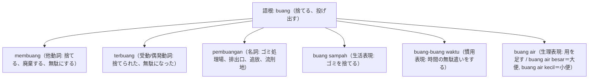

# 語根 buang の全派生語図鑑（membuang, terbuang, pembuangan）

「廃棄・捨てる・浪費・追放」を司る環境・生活・時間の語根 **buang** の派生語ネットワークです。

---

## 1. 語根 buang からの派生語ファミリー

---

## 2. 各派生語の詳細解説と例文

### ① membuang sampah pada tempatnya（ゴミを所定の場所に捨てる）
- インドネシア全土の看板や学校で最もよく見かける標語です。

Dilarang membuang sampah sembarangan di sepanjang aliran sungai demi mencegah banjir.

洪水を防ぐため、河川敷沿いにゴミをポイ捨て（無造作に投棄）することは禁止されています。

dilarang membuang sampah sembarangan（ゴミのポイ捨て禁止） / aliran sungai（河川流域）。

### ② buang-buang waktu（時間の浪費） vs terbuang sia-sia（無駄に終わる）

Berdebat tanpa data yang akurat hanya akan buang-buang waktu dan energi tim.

正確なデータなしで議論することは、チームの時間とエネルギーを浪費する（無駄にする）だけに終わります。

buang-buang waktu（時間を浪費する） / data yang akurat（正確なデータ）。

---

## 3. 理解度チェッククイズ

Q1. 「ゴミをポイ捨てしないでください」の看板文句「ゴミを捨てる」は？

<strong>正解: membuang sampah</strong> 
解説: 語根 buang に me- がついて membuang となります。

Q2. 病院や公の場で「お手洗い・用を足す」の丁寧な言い回しは？

<strong>正解: buang air（buang air kecil / besar）</strong> 
解説: 水を捨てる＝用を足すという婉曲表現です。

