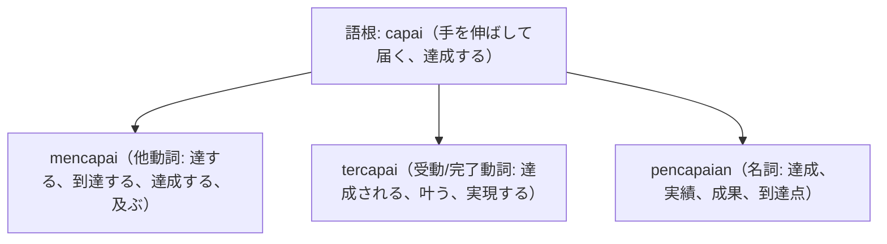

# 語根 capai の全派生語図鑑（mencapai, tercapai, pencapaian）

「到達・達成・目標・業績」を司るターゲット達成の最重要語根 **capai** の派生語ネットワークです。

---

## 1. 語根 capai からの派生語ファミリー

---

## 2. 各派生語の詳細解説と例文

### ① mencapai angka / target（数字・目標に達する）
- ニュース、ビジネス、目標管理（KPI）で毎日使われます。

Nilai perdagangan bilateral antara Indonesia dan Jepang mencapai rekor tertinggi dalam dekade terakhir.

インドネシアと日本との二国間貿易額は、過去10年間で最高記録に達しました。

perdagangan bilateral（二国間貿易） / mencapai rekor tertinggi（最高記録に達する）。

### ② tercapai（達成される、夢が叶う） vs pencapaian luar biasa（並外れた業績）

Cita-cita mulia untuk mendirikan sekolah gratis bagi anak yatim akhirnya dapat tercapai.

孤児たちのための無料学校を設立するという気高い志（夢）は、ついに達成されました（実現しました）。

cita-cita mulia（気高い夢・志） / tercapai（叶う、達成される）。

Manajer memberikan penghargaan atas pencapaian luar biasa tim penjualan sepanjang kuartal pertama.

部長は、第1四半期を通じた営業チームの素晴らしい業績（達成度）に対して表彰を行いました。

memberikan penghargaan（表彰する） / pencapaian luar biasa（並外れた達成・実績）。

---

## 3. 理解度チェッククイズ

Q1. 「夢や目標が叶う、達成される」という完了形動詞は？

<strong>正解: tercapai</strong> 
解説: 接頭辞 ter- がついて「達成された状態」を表します。

Q2. 「売上が10億ルピアに達する」の「達する」は？

<strong>正解: mencapai（mencapai satu miliar rupiah）</strong> 
解説: 目標数値に届く他動詞は mencapai を用います。

