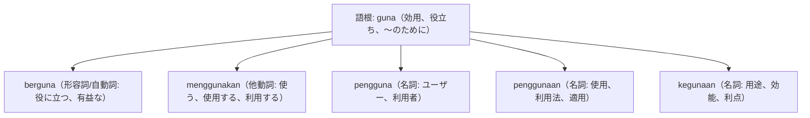

# 語根 guna の全派生語図鑑（berguna, menggunakan, penggunaan, pengguna, kegunaan）

「効用・使用・利用」に関する全概念を司る重要語根 **guna** の派生語ネットワークです。

---

## 1. 語根 guna からの派生語ファミリー

---

## 2. 各派生語の詳細解説と例文

### ① menggunakan（他動詞: 使う） vs pengguna（ユーザー）

Aplikasi pembayaran digital ini sudah digunakan oleh puluhan juta pengguna aktif di seluruh Indonesia.

このデジタル決済アプリは、インドネシア全土の何千万人ものアクティブユーザーによってすでに利用されています。

digunakan（使われている） / pengguna aktif（アクティブユーザー）。

### ② berguna（有益な） vs kegunaan（用途・効能）

Tips mengelola keuangan pribadi ini sangat berguna bagi para profesional muda yang baru bekerja.

個人の家計管理に関するこのアドバイスは、働き始めたばかりの若手プロフェッショナルにとって非常に役立ちます。

mengelola keuangan pribadi（個人家計を管理する） / sangat berguna（とても役に立つ）。

---

## 3. 理解度チェッククイズ

Q1. スマホアプリの「ユーザー、利用者」を表す単語は？

<strong>正解: pengguna</strong> 
解説: 接頭辞 peng- がついて「使う人＝ユーザー」を表します。

Q2. 「この情報は非常に役に立ちます」の「役に立つ」は？

<strong>正解: berguna</strong> 
解説: 接頭辞 ber- がついて「効用・役立ちを持つ＝役に立つ」となります。

