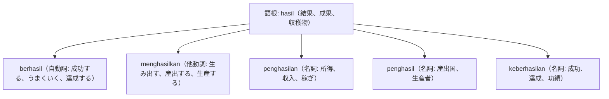

# 語根 hasil の全派生語図鑑（berhasil, menghasilkan, penghasilan, keberhasilan）

「成果・産出・所得・成功」という生産活動と達成の象徴語根 **hasil** の派生語ネットワークです。

---

## 1. 語根 hasil からの派生語ファミリー

---

## 2. 各派生語の詳細解説と例文

### ① berhasil（成功する） vs keberhasilan（成功・業績）

Setelah melewati berbagai rintangan berat, tim peneliti akhirnya berhasil menemukan vaksin baru.

幾重もの困難な障害を乗り越えた末、研究チームはついに新ワクチンの開発に成功しました。

rintangan berat（重い障害） / berhasil menemukan（発見・開発に成功する）。

Keberhasilan proyek ini tidak lepas dari kerja sama yang solid antar anggota divisi.

本プロジェクトの成功は、部門メンバー間の強固なチームワークの賜物です。

keberhasilan proyek（プロジェクトの成功） / tidak lepas dari（〜のおかげである、〜と切り離せない）。

### ② menghasilkan（産出する） vs penghasilan（所得・収入）

Indonesia merupakan salah satu negara penghasil nikel terbesar di dunia yang menghasilkan devisa negara tinggi.

インドネシアは、高い国家外貨収入を生み出している世界最大級のニッケル産出国の一つです。

negara penghasil（産出国） / menghasilkan devisa（外貨を生み出す）。

Laporan pajak tahunan mencantumkan total penghasilan kena pajak dari usaha perdagangan.

年次納税申告書には、商業事業からの課税対象総所得が記載されています。

laporan pajak tahunan（年次確定申告書） / penghasilan kena pajak（課税所得）。

---

## 3. 理解度チェッククイズ

Q1. 「成功する、成し遂げる」を意味する自動詞は？

<strong>正解: berhasil</strong> 
解説: 語根 hasil に接頭辞 ber- がついて「結果を得る＝成功する」となります。

Q2. 税務や家計で頻出する「所得、収入」を表す名詞は？

<strong>正解: penghasilan</strong> 
解説: 接頭辞 peng- と接尾辞 -an で「稼ぎ、所得」を意味します。

