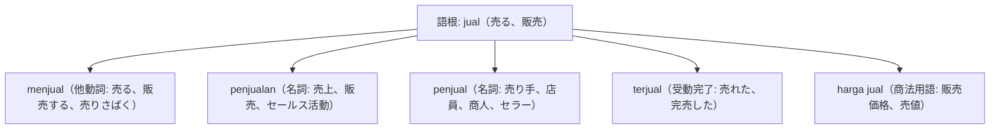

# 語根 jual の全派生語図鑑（menjual, penjualan, penjual, terjual）

「販売・セールス・売り上げ・完売」を司る商業とビジネス収益の語根 **jual** の派生語ネットワークです。

---

## 1. 語根 jual からの派生語ファミリー

---

## 2. 各派生語の詳細解説と例文

### ① target penjualan（売上目標）
- 営業現場・経営会議の定番用語です。

Divisi pemasaran berhasil melampaui target penjualan semester pertama sebesar 15 persen.

マーケティング（営業）部門は、第1半期の売上目標を15パーセント上回ることに成功しました。

target penjualan（売上ターゲット） / melampaui（〜を超える、上回る）。

### ② terjual habis（完売した、ソールドアウト）

Tiket konser musik grup idola tersebut langsung terjual habis hanya dalam waktu sepuluh menit.

そのアイドルグループの音楽コンサートのチケットは、わずか10分のうちに即座に完売（ソールドアウト）しました。

terjual habis（完売する） / dalam waktu sepuluh menit（10分のうちに）。

---

## 3. 理解度チェッククイズ

Q1. 「チケットが完売した」の定番表現は？

<strong>正解: terjual habis（habis terjual）</strong> 
解説: 売れた（terjual）＋ 尽きた（habis）。

Q2. 企業の「売上目標」をインドネシア語で言うと？

<strong>正解: target penjualan</strong> 
解説: 語根 jual に接頭辞 pen- と接尾辞 -an がついた penjualan（販売・売上）。

