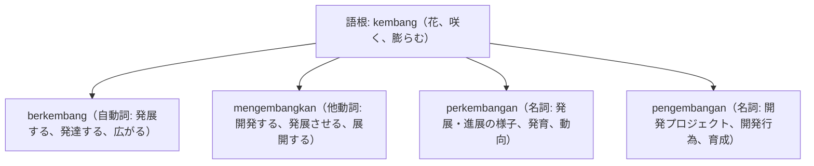

# 語根 kembang の全派生語図鑑（berkembang, mengembangkan, perkembangan, pengembangan）

「開花・発展・展開」を意味する経済・教育・成長の重要語根 **kembang** の派生語ネットワークです。

---

## 1. 語根 kembang からの派生語ファミリー

---

## 2. 各派生語の詳細解説と例文

### ① berkembang（自動詞: 発展する） vs mengembangkan（他動詞: 〜を開発・育成する）
- **negara berkembang**: 発展途上国（現在進行形で発展している国）。

Ekosistem startup di kawasan Asia Tenggara terus berkembang dengan sangat dinamis dan pesat.

東南アジア地域のスタートアップ・エコシステムは、極めてダイナミックかつ急速に発展し続けています。

ekosistem startup（スタートアップ生態系） / berkembang pesat（急速に発展する）。

Tim insinyur kami sedang mengembangkan aplikasi mobile berbasis kecerdasan buatan.

当社のエンジニアチームは、人工知能をベースにしたモバイルアプリを開発しています。

mengembangkan aplikasi（アプリを開発する） / kecerdasan buatan（AI）。

### ② perkembangan（動向・進展） vs pengembangan（開発事業）
- 類義語として混同しやすい名詞の使い分けです。
- **perkembangan**: 自然な推移や状況（perkembangan situasi＝事態の進展）。
- **pengembangan**: 人為的な開発活動（pengembangan produk＝製品開発、R&D）。

Manajer proyek selalu melaporkan perkembangan terbaru terkait pembangunan fasilitas pabrik.

プロジェクトマネージャーは、工場施設の建設に関する最新の進展状況を常に報告しています。

perkembangan terbaru（最新の進展・動向） / pembangunan fasilitas（施設建設）。

---

## 3. 理解度チェッククイズ

Q1. 「発展途上国」をインドネシア語で言うと？

<strong>正解: negara berkembang</strong> 
解説: 自ら発展している国という意味で自動詞 berkembang が名詞 negara を修飾します。

Q2. 「研究開発（R&D）」の「開発」を表す人為的な開発名詞は？

<strong>正解: pengembangan（penelitian dan pengembangan）</strong> 
解説: 意図的に開発する活動には peng-...-an を用いた pengembangan を使います。

