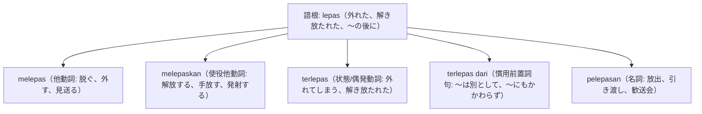

# 語根 lepas の全派生語図鑑（melepas, melepaskan, terlepas, pelepasan）

「解放・外す・脱ぐ・〜は別として」という自由と分離を司る語根 **lepas** の派生語ネットワークです。

---

## 1. 語根 lepas からの派生語ファミリー

---

## 2. 各派生語の詳細解説と例文

### ① melepas（脱ぐ、外す） vs melepaskan（手放す、解放する）

Silakan melepas sepatu dan menyimpannya di rak sebelum masuk ke dalam rumah ibadah.

礼拝堂の中に入る前に、靴を脱いで下駄箱に収納してください。

melepas sepatu（靴を脱ぐ） / rak sepatu（下駄箱）。

Pemerintah melepaskan ratusan ekor tukik ke laut lepas untuk menjaga kelestarian penyu.

政府はウミガメの保護のため、何百匹ものウミガメの幼体を外海へ放流（解放）しました。

melepaskan tukik（子亀を放流する） / laut lepas（公海・外海）。

### ② terlepas dari（慣用句: 〜はさておき、〜に関わらず）
- 論文や議論・論説文の超頻出接続表現です。

Terlepas dari berbagai kontroversi yang ada, kebijakan baru ini memberikan dampak positif bagi perekonomian warga.

様々な物議を醸している点はさておき、この新政策は市民の経済に好影響を与えています。

terlepas dari kontroversi（物議・論争はさておき）。

---

## 3. 理解度チェッククイズ

Q1. 「靴を脱ぐ」のインドネシア語表現は？

<strong>正解: melepas sepatu</strong> 
解説: 衣類や履物を「脱ぐ・外す」は melepas を使います。

Q2. 「議論の相違はさておき」という前置詞表現は？

<strong>正解: terlepas dari</strong> 
解説: terlepas dari ... で「〜は別として、〜を度外視して」という重要表現です。

