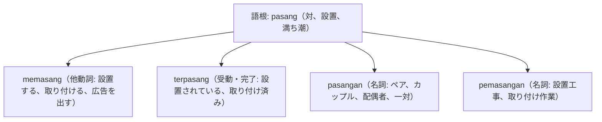

# 語根 pasang の全派生語図鑑（memasang, terpasang, pasangan, pemasangan）

「設置・装着・ペア（一対）」を表す日常・工事・ビジネス必修語根 **pasang** の派生語ネットワークです。

---

## 1. 語根 pasang からの派生語ファミリー

---

## 2. 各派生語の詳細解説と例文

### ① memasang（他動詞: 取り付ける、掲載する）
- 家電の設置から広告の出稿（memasang iklan）まで幅広く使われます。

Teknisi sedang memasang unit pendingin udara baru di ruang rapat lantai dua.

技術者が2階の会議室に新しいエアコンを取り付けています。

memasang pendingin udara（エアコンを取り付ける） / ruang rapat（会議室）。

Perusahaan kami berencana memasang iklan lowongan kerja di media daring terkemuka.

弊社は著名なオンラインメディアに求人広告を掲載する計画です。

memasang iklan（広告を出す） / lowongan kerja（求人枠）。

### ② pasangan（ペア、パートナー、カップル）

Pasangan pengantin baru itu mendapat ucapan selamat dari para tamu undangan.

その新婚カップルは、招待客の皆さんから温かいお祝いの言葉を受け取りました。

pasangan pengantin baru（新婚カップル） / tamu undangan（招待客）。

---

## 3. 理解度チェッククイズ

Q1. 「エアコンを設置する」の動詞は？

<strong>正解: memasang AC</strong> 
解説: 機器や部品を取り付ける動詞は memasang です。

Q2. 「求人広告を出す」と言う場合、広告（iklan）とセットにする動詞は？

<strong>正解: memasang iklan</strong> 
解説: 広告を「掲示する・出稿する」というコロケーションでも memasang が定番です。

