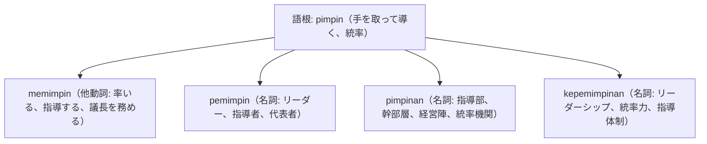

# 語根 pimpin の全派生語図鑑（memimpin, pemimpin, pimpinan, kepemimpinan）

「統率・指導・経営層・リーダーシップ」を司る組織・マネジメント語根 **pimpin** の派生語ネットワークです。

---

## 1. 語根 pimpin からの派生語ファミリー

---

## 2. 各派生語の詳細解説と例文

### ① pemimpin（リーダー個人） vs pimpinan（幹部組織・役員陣）
- **pemimpin**: リーダーという個々の人間（pemimpin masa depan＝未来のリーダー）。
- **pimpinan**: 組織のトップ層・経営幹部全体（rapat pimpinan＝幹部会議）。

Direktur Utama memimpin rapat pimpinan bulanan untuk mengevaluasi kinerja perusahaan.

社長は、会社の業績を評価するための月次幹部会議を自ら主宰（統率）しました。

memimpin rapat（会議を主宰・リードする） / rapat pimpinan（幹部会議、役員会）。

### ② kepemimpinan（リーダーシップ・統率力）

Gaya kepemimpinan yang partisipatif mampu meningkatkan motivasi dan loyalitas karyawan.

参加型のリーダーシップスタイルは、従業員のモチベーションと忠誠心を高めることができます。

gaya kepemimpinan（リーダーシップスタイル） / partisipatif（参加型） / loyalitas karyawan（従業員の忠誠心）。

---

## 3. 理解度チェッククイズ

Q1. 「リーダーシップ研修」の「リーダーシップ」は？

<strong>正解: kepemimpinan（pelatihan kepemimpinan）</strong> 
解説: 接頭辞 ke- と接尾辞 -an で抽象名詞「統率力・リーダーシップ」を表します。

Q2. 会議で「議長を務める、会議を率いる」の動詞は？

<strong>正解: memimpin rapat</strong> 
解説: 語根 pimpin に me- がついて memimpin となります。

