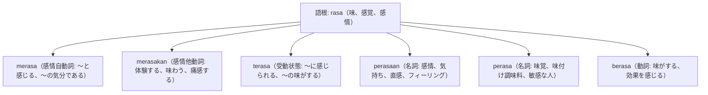

# 語根 rasa の全派生語図鑑（merasa, merasakan, perasaan, perasa, terasa）

舌で感じる「味」、肌で感じる「感触」、心で感じる「感情・気分」の全てを結ぶ多機能語根 **rasa** の派生語ネットワークです。

---

## 1. 語根 rasa からの派生語ファミリー

---

## 2. 各派生語の詳細解説と例文

### ① merasa（自動詞） vs merasakan（他動詞）の使い分け
- **merasa [形容詞]**: 自分が〜だと感じる。
  - *Saya merasa lapar / lelah.*（私は空腹／疲労を感じる。）
- **merasakan [目的語名詞]**: [物事・苦難]を肌で実感する、味わう。
  - *Kami merasakan dampak positifnya.*（私たちはその好影響を実感した。）

Warga di daerah pelosok akhirnya dapat merasakan aliran listrik dan akses internet yang stabil.

僻地の住民たちは、安定した電気とインターネット接続の恩恵をついに実感する（体験する）ことができました。

merasakan aliran listrik（電気の供給を実感・享受する） / daerah pelosok（僻地）。

### ② terasa（受動状態: 感じられる、〜の気配がする）

Hawa dingin pegunungan terasa menusuk tulang saat angin malam berembus kencang.

夜風が強く吹き抜ける時、山の冷気が骨に染みるように感じられました（terasa）。

terasa menusuk tulang（骨に突き刺さるように感じられる）。

### ③ perasaan（名詞: 感情、心情、フィーリング）

Jaga ucapanmu agar tidak melukai perasaan orang lain yang sedang tertimpa musibah.

災難に見舞われている他人の感情（気持ち）を傷つけないよう、言葉遣いに気をつけなさい。

melukai perasaan（気持ちを傷つける） / tertimpa musibah（災難に遭う）。

---

## 3. 理解度チェッククイズ

Q1. 「私は今日とても疲れていると感じる」と言う時の動詞は、merasa か merasakan のどちら？

<strong>正解: merasa lelah</strong> 
解説: 直後に形容詞（lelah）が来る場合は、自動詞「merasa」を使います。

Q2. 相手の「気持ち、心情」を表す名詞は？

<strong>正解: perasaan</strong> 
解説: 周囲辞 per-...-an により「内面的な感情・心情」を意味します。

