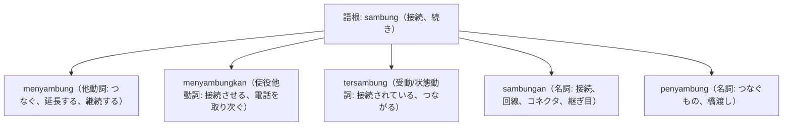

# 語根 sambung の全派生語図鑑（menyambung, menyambungkan, tersambung, sambungan, penyambung）

「接続・結合・通話をつなぐ」というIT・インフラ・コミュニケーションの必須語根 **sambung** の派生語ネットワークです。

---

## 1. 語根 sambung からの派生語ファミリー

---

## 2. 各派生語の詳細解説と例文

### ① menyambungkan（電話を取り次ぐ、接続する）
- オフィスの電話取次ぎフレーズで頻出します。

Mohon tunggu sebentar, saya akan menyambungkan panggilan Anda ke bagian pemasaran.

少々お待ちください、マーケティング部門へお電話をおつなぎいたします。

menyambungkan panggilan（通話を取り次ぐ） / bagian pemasaran（営業部・マーケ部）。

### ② tersambung（接続完了している） vs sambungan internet（ネット回線）

Komputer laptop Anda telah berhasil tersambung ke jaringan Wi-Fi kantor dengan sinyal yang kuat.

あなたのノートパソコンは、強い信号でオフィスのWi-Fiネットワークに正常に接続されました。

tersambung ke jaringan（ネットワークに接続された） / sinyal yang kuat（強い電波信号）。

---

## 3. 理解度チェッククイズ

Q1. 「電話を〜課におつなぎします」の動詞は？

<strong>正解: menyambungkan</strong> 
解説: 人と人を「電話などで接続させる」使役他動詞 menyambungkan を使います。

Q2. 「インターネット回線」を意味する名詞句は？

<strong>正解: sambungan internet</strong> 
解説: 接尾辞 -an がついた sambungan（接続、回線）＋ internet。

