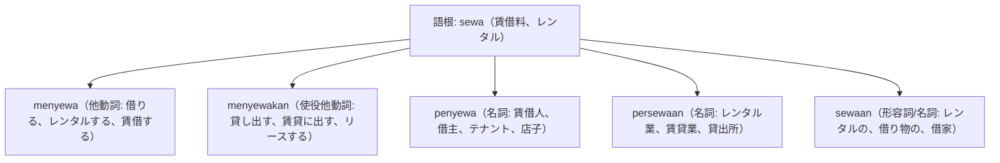

# 語根 sewa の全派生語図鑑（menyewa, menyewakan, penyewa, persewaan, sewaan）

「賃貸・リース・レンタル・借主」を司る不動産・自動車・生活の重要語根 **sewa** の派生語ネットワークです。

---

## 1. 語根 sewa からの派生語ファミリー

---

## 2. 各派生語の詳細解説と例文

### ① menyewa（借りる） vs menyewakan（貸す）
- 主客が逆転する文法的に最も重要な派生語の対比です。
- **menyewa**: 借主が「お金を払って借りる」。
- **menyewakan**: 大家や貸主が「貸し出す（使役接尾辞 -kan）」。

Ekspatriat asal Tokyo itu memutuskan menyewa apartemen furnished di kawasan Jakarta Selatan selama dua tahun.

東京出身のその駐在員は、南ジャカルタ地域の家具付きアパートを2年間賃借（契約）することを決めました。

menyewa apartemen（アパートを借りる） / apartemen furnished（家具付きアパート）。

Pemilik gedung menyewakan lantai dasar kepada jaringan kedai kopi internasional.

ビルのオーナーは、1階（地上階）を国際的なコーヒーチェーンに賃貸（貸出）しました。

menyewakan lantai dasar（1階を貸し出す） / kedai kopi internasional（国際カフェチェーン）。

### ② biaya sewa（賃料） vs penyewa（テナント・借主）

Penyewa wajib melunasi biaya sewa tahunan sebelum batas waktu penyerahan kunci unit.

テナント（借主）は、部屋の鍵の引き渡し期限までに年次賃料を完納する義務があります。

penyewa（借主、テナント） / biaya sewa tahunan（年間家賃） / penyerahan kunci（鍵の引き渡し）。

---

## 3. 理解度チェッククイズ

Q1. 大家さんが「部屋を誰かに貸す」ときの他動詞は？

<strong>正解: menyewakan</strong> 
解説: 貸し出す（相手に使わせる）使役の -kan がついて menyewakan となります。自分が借りるのは menyewa です。

Q2. アパートやオフィスの「借主、テナント」を表す単語は？

<strong>正解: penyewa</strong> 
解説: 語根 sewa に接頭辞 peng- がついて「借りる人＝賃借人」を表します。

