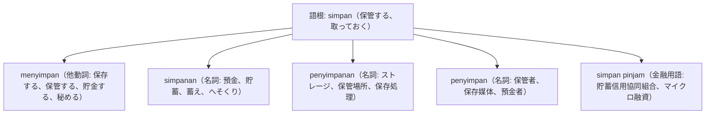

# 語根 simpan の全派生語図鑑（menyimpan, simpanan, penyimpanan, penyimpan）

「保存・保管・預金・キープ」を司るデータ管理・金融・日常の重要語根 **simpan** の派生語ネットワークです。

---

## 1. 語根 simpan からの派生語ファミリー

---

## 2. 各派生語の詳細解説と例文

### ① menyimpan file / uang（ファイルを保存する／お金を貯金する）
- パソコンの「上書き保存」から銀行預金まで同じ動詞です。

Jangan lupa selalu menyimpan cadangan file penting di media penyimpanan awan (cloud).

クラウドストレージ（保管媒体）に重要ファイルのバックアップを常に保存することを忘れないでください。

menyimpan cadangan file（ファイルのバックアップを保存する） / penyimpanan awan（クラウドストレージ）。

### ② simpan pinjam（信用協同組合: コペラシ）
- インドネシア全土の地域経済を支える「Koperasi Simpan Pinjam（KSP）」の核となる単語です。

Koperasi simpan pinjam desa memberikan kemudahan pinjaman modal usaha bagi para petani lokal.

村の貯蓄信用協同組合（KSP）は、地元の農民たちに事業資金ローンの利便性を提供しています。

koperasi simpan pinjam（貯蓄信用協同組合） / modal usaha（事業資金）。

---

## 3. 理解度チェッククイズ

Q1. PCやスマホの「データを保存する」の動詞は？

<strong>正解: menyimpan data</strong> 
解説: 語根 simpan に me- がついて menyimpan となります。

Q2. 銀行や信用金庫の「預金・貯蓄」を表す名詞は？

<strong>正解: simpanan / tabungan</strong> 
解説: 語根 simpan に接尾辞 -an がついた simpanan が「預金・蓄え」を意味します。

