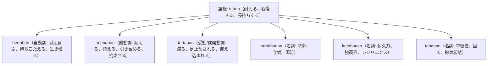

# 語根 tahan の全派生語図鑑（bertahan, menahan, tertahan, pertahanan, ketahanan）

「耐久・抑制・防衛・耐える」という強靭さを司る語根 **tahan** の派生語ネットワークです。

---

## 1. 語根 tahan からの派生語ファミリー

---

## 2. 各派生語の詳細解説と例文

### ① bertahan（持ちこたえる） vs menahan（抑える・拘束する）

Banyak usaha mikro kecil mampu bertahan di tengah krisis ekonomi berkat inovasi produk.

多くの零細中小企業は、製品のイノベーションのおかげで経済危機の中でも持ちこたえることができました。

mampu bertahan（持ちこたえることができる） / krisis ekonomi（経済危機）。

Petugas imigrasi terpaksa menahan paspor penumpang tersebut karena visa kedaluwarsa.

入国審査官は、ビザが失効していたためやむを得ずその乗客のパスポートを差し押さえ（留め置き）ました。

menahan paspor（パスポートを差し押さえる・留置する） / visa kedaluwarsa（失効したビザ）。

### ② ketahanan pangan（食料安全保障）
- 国家政策ニュースの頻出キーワードです。

Pemerintah memprioritaskan program ketahanan pangan nasional guna mengantisipasi krisis pangan global.

政府は、世界的な食料危機を未然に防ぐため、国家食料安全保障プログラムを最優先課題としています。

ketahanan pangan（食料安全保障・食料自給耐力） / mengantisipasi（見越して対処する）。

---

## 3. 理解度チェッククイズ

Q1. ニュースで頻出の「食料安全保障」のインドネシア語は？

<strong>正解: ketahanan pangan</strong> 
解説: ketahanan（耐性・安全保障能力）＋ pangan（食料）。

Q2. 「怒りや涙をぐっとこらえる・抑える」ときの他動詞は？

<strong>正解: menahan（menahan amarah / menahan tangis）</strong> 
解説: 感情や物体を内側に抑え留める他動詞は menahan です。

