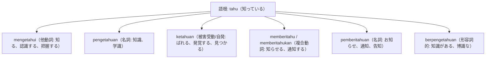

# 語根 tahu の全派生語図鑑（mengetahui, pengetahuan, ketahuan, pemberitahuan）

インドネシア語の最も重要な認識動詞である語根 **tahu（知る、分かる）** は、接辞がつくことで「知識」「通知」「発覚」「通知書」など多彩な意味へ派生します。

中上級の読解やビジネス、公的文書で必須となる派生語を完全整理します。

---

## 1. 語根 tahu からの派生語ファミリー

---

## 2. 各派生語の詳細解説と例文

### ① mengetahui（他動詞: 知る、把握する、認識する）
- **用法**: 公式文書やビジネスで「事実や情報を知る、承知する」という意味で使われます。

Manajemen perlu mengetahui alasan mendasar di balik penurunan penjualan produk ini.

経営陣は、本製品の売上減少の背後にある根本的な理由を把握する必要があります。

mengetahui（把握する、知る） / alasan mendasar（根本的理由）。

### ② pengetahuan（名詞: 知識、学術的理解）
- **用法**: ilmupengetahuan（科学・学問）、pengetahuan umum（一般常識）。

Membaca buku secara rutin dapat memperluas wawasan dan menambah pengetahuan kita.

定期的に本を読むことは、私たちの視野を広げ、知識を増やすことができます。

memperluas wawasan（視野を広げる） / menambah pengetahuan（知識を増やす）。

### ③ ketahuan（被害受動・自発: バレる、発覚する）
- **用法**: 周囲辞 ke-...-an による「隠していた悪事や秘密が意図せず見つかってしまう」口語・日常語。

Dia ketahuan menyontek saat ujian akhir dan langsung mendapat sanksi dari pihak sekolah.

彼は期末試験でカンニングしたことがバレて（発覚して）、学校側から直ちに処分を受けました。

ketahuan menyontek（カンニングが発覚する） / sanksi（処分・罰則）。

### ④ memberitahukan / pemberitahuan（知らせる / 通知書）
- **用法**: 社内通知（surat pemberitahuan）、公式なアナウンス。

Surat pemberitahuan resmi mengenai jadwal libur nasional telah dikirimkan ke seluruh staf.

祝日スケジュールに関する公式通知書が、全スタッフ宛てに送付されました。

surat pemberitahuan（通知書） / resmi（公式の）。

---

## 3. 理解度チェッククイズ

Q1. 「 ilmu pengetahuan 」の日本語訳は？

<strong>正解: 科学、学術知識</strong> 
解説: ilmu（学問）＋ pengetahuan（知識）で自然科学や学術全般を指します。

Q2. 「隠していた秘密がバレる、露見する」を表す口語的な派生語は？

<strong>正解: ketahuan</strong> 
解説: ke-...-an による被害・偶発受動で「見つかる、バレる」を表します。

