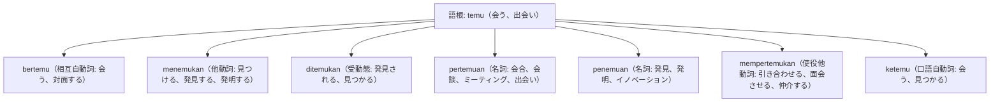

# 語根 temu の全派生語図鑑（bertemu, menemukan, pertemuan, penemuan, mempertemukan）

「出会う、再会する」という人間関係から、「発見する、見つけ出す」という探究、さらには「引き合わせる」という仲介まで幅広く派生する語根 **temu** のネットワークです。

---

## 1. 語根 temu からの派生語ファミリー

---

## 2. 各派生語の詳細解説と例文

### ① bertemu（自動詞: 会う、対面する） vs menemukan（他動詞: 見つける）
- **bertemu dengan**: [人]と会う（相互行為）。
- **menemukan**: 探していた[物・人・アイデア]を見つけ出す。

Setelah berdiskusi intensif selama dua hari, para perunding akhirnya menemukan jalan keluar terbaik.

2日間の集中協議の末、交渉担当者たちはついに最善の解決策（出口）を見出しました。

menemukan jalan keluar（解決策・出口を見出す） / perunding（交渉官）。

### ② pertemuan（名詞: 会合、対面） vs penemuan（名詞: 発見・発明）
- **pertemuan**: 人が集まるミーティング（pertemuan puncak＝首脳会談）。
- **penemuan**: 科学的な大発見や新技術（penemuan ilmiah＝科学的発見）。

Penemuan teknologi kecerdasan buatan telah membawa revolusi besar dalam dunia industri global.

人工知能（AI）技術の発明・発見は、世界の産業界に巨大な革命をもたらしました。

penemuan teknologi（技術の発明） / kecerdasan buatan（人工知能 / AI）。

### ③ mempertemukan（使役他動詞: 引き合わせる、面会させる）

Pemerintah berupaya mempertemukan perwakilan buruh dan asosiasi pengusaha untuk mencapai mufakat.

政府は、合意に達するために労働者代表と経営者団体を引き合わせよう（対談させよう）と努めました。

mempertemukan（引き合わせる、対面させる） / mencapai mufakat（合意に達する）。

---

## 3. 理解度チェッククイズ

Q1. 「国家首脳会談（サミット）」を表す公式用語は？

<strong>正解: Pertemuan Puncak（または KTT: Konferensi Tingkat Tinggi）</strong> 
解説: pertemuan（会合）＋ puncak（頂上・サミット）で首脳会談を指します。

Q2. 「探していたものを見つけ出す、新事実を発見する」を表す他動詞は？

<strong>正解: menemukan</strong> 
解説: 語根 temu が鼻音化して men- となり、接尾辞 -kan がついて他動詞「見つける」となります。

