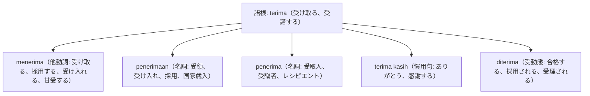

# 語根 terima の全派生語図鑑（menerima, penerimaan, penerima, terima kasih）

「受領・受容・感謝・合格」を司る人間関係とコミュニケーションの集大成語根 **terima** の派生語ネットワークです。

---

## 1. 語根 terima からの派生語ファミリー

---

## 2. 各派生語の詳細解説と例文

### ① terima kasih（ありがとう）の語源
- **terima**（受け取る）＋ **kasih**（愛、情愛）＝「あなたの愛情を受け取りました」という温かい感謝の表現です。

Terima kasih banyak atas bantuan dan keramahan luar biasa yang Anda berikan kepada kami sekeluarga.

私たち家族に対して施してくださった多大なるご援助と並外れたおもてなしに、心より感謝申し上げます。

terima kasih banyak（本当にありがとう） / keramahan luar biasa（並外れた親切心・ホスピタリティ）。

### ② diterima di universitas / perusahaan（大学・企業に合格する・採用される）

Adik merasa sangat bahagia dan bersyukur setelah dinyatakan diterima di fakultas kedokteran impiannya.

弟は、念願だった憧れの医学部に合格した（受け入れられた）と発表され、非常に喜び感謝しました。

dinyatakan diterima（合格と発表された） / fakultas kedokteran（医学部）。

### ③ penerimaan negara（国家歳入）
- 経済ニュースで税収や歳入を表す公式用語です。

Realisasi penerimaan pajak negara tahun ini berhasil mencapai target yang ditetapkan dalam APBN.

今年度の国家税収（租税歳入）の実行額は、国家予算案（APBN）で定められた目標を達成することに成功しました。

penerimaan pajak（税収） / realisasi（実現額、執行実績）。

---

## 3. 理解度チェッククイズ

Q1. 「就職試験に合格した、内定をもらった」の動詞表現は？

<strong>正解: diterima bekerja / diterima di perusahaan</strong> 
解説: 会社に受け入れられる（diterima）という受動態が「採用される・内定を得る」を表します。

Q2. 国民的感謝の挨拶「terima kasih」の「kasih」の原義は？

<strong>正解: 愛・愛情（愛を受け取る）</strong> 
解説: terima（受け取る）＋ kasih（愛・情愛）から成り立っています。

