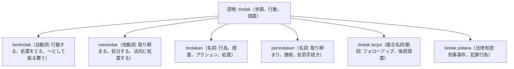

# 語根 tindak の全派生語図鑑（bertindak, menindak, tindakan, penindakan）

「行動・決断・法的措置・処置」を司る厳格な実務・法律語根 **tindak** の派生語ネットワークです。

---

## 1. 語根 tindak からの派生語ファミリー

---

## 2. 各派生語の詳細解説と例文

### ① tindakan（名詞: 措置、アクション） vs bertindak cepat（迅速に行動する）

Manajemen segera mengambil tindakan tegas untuk menyelesaikan masalah kebocoran data pelanggan.

経営陣は、顧客データ漏洩問題を解決するために直ちに断固たる措置（アクション）を講じました。

mengambil tindakan tegas（断固たる措置を取る） / kebocoran data（データ漏洩）。

### ② menindak tegas（厳正に取り締まる） vs tindak lanjut（フォローアップ）

Aparat penegak hukum berjanji akan menindak tegas segala bentuk tindak pidana korupsi tanpa pandang bulu.

法執行当局は、一切の忖度なくあらゆる形態の汚職犯罪行為を厳正に取り締まる（処罰する）と明言しました。

menindak tegas（厳しく取り締まる） / tindak pidana korupsi（汚職刑事犯罪） / tanpa pandang bulu（えこひいき・忖度なく）。

Hasil audit internal ini memerlukan tindak lanjut konkret dari pimpinan departemen terkait.

この内部監査の結果は、関連部門の責任者による具体的なフォローアップ（後続措置）を必要としています。

tindak lanjut konkret（具体的なフォローアップ・事後措置）。

---

## 3. 理解度チェッククイズ

Q1. ビジネスで「フォローアップ（後続対応）」を意味する重要用語は？

<strong>正解: tindak lanjut（TL）</strong> 
解説: 会議議事録や監査で「今後の対応」として必須の単語です。

Q2. 「断固たる措置を講じる」の定型フレーズは？

<strong>正解: mengambil tindakan tegas</strong> 
解説: 措置（tindakan）を取る（mengambil）＋ tegas（断固とした）。

