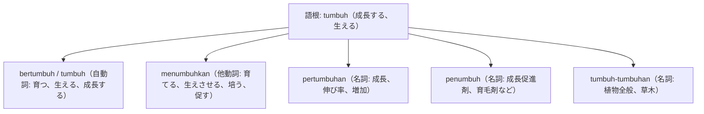

# 語根 tumbuh の全派生語図鑑（bertumbuh, menumbuhkan, pertumbuhan, penumbuh）

「植物の成長・経済成長・育成」を象徴する語根 **tumbuh** の派生語ネットワークです。

---

## 1. 語根 tumbuh からの派生語ファミリー

---

## 2. 各派生語の詳細解説と例文

### ① tumbuh / bertumbuh（自動詞: 成長する）
- 草木が生えることにも、子どもの成長にも、経済成長にも使われます。

Pohon mangga yang ditanam ayah di halaman belakang kini tumbuh subur dan mulai berbuah lebat.

父が裏庭に植えたマンゴーの木は、今では青々とよく茂り、たわわに実をつけ始めています。

tumbuh subur（すくすくと育つ、豊かに茂る） / berbuah lebat（実が豊富になる）。

### ② pertumbuhan ekonomi（経済成長） vs menumbuhkan（培う）
- 経済ニュースの主役である **pertumbuhan ekonomi**（経済成長率）。

Bank sentral memproyeksikan pertumbuhan ekonomi nasional akan mencapai lebih dari lima persen tahun ini.

中央銀行は、今年の国家経済成長率が5パーセント超に達すると予測しています。

pertumbuhan ekonomi（経済成長） / mencapai lebih dari lima persen（5%超に達する）。

Program magang ini bertujuan menumbuhkan jiwa kepemimpinan dan kemandirian bagi mahasiswa.

このインターンシッププログラムは、大学生のリーダーシップ精神と自立心を育むことを目的としています。

menumbuhkan jiwa kepemimpinan（リーダーシップ精神を育む）。

---

## 3. 理解度チェッククイズ

Q1. 経済ニュースの最重要表現「経済成長」は？

<strong>正解: pertumbuhan ekonomi</strong> 
解説: 語根 tumbuh に per-...-an がついた pertumbuhan（成長）＋ ekonomi（経済）。

Q2. 「草木、植物たち」を表す重複語は？

<strong>正解: tumbuh-tumbuhan</strong> 
解説: 語根 tumbuh を反復し接尾辞 -an をつけることで「植物類全般」を表します。

