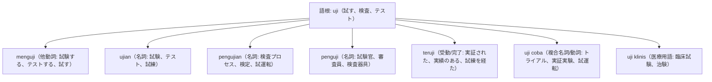

# 語根 uji の全派生語図鑑（menguji, ujian, pengujian, penguji, teruji）

「試験・検査・臨床試験・実証済み」を司る学術・品質管理の最重要語根 **uji** の派生語ネットワークです。

---

## 1. 語根 uji からの派生語ファミリー

---

## 2. 各派生語の詳細解説と例文

### ① ujian（試験） vs teruji（実証された・信頼できる）
- **kualitas teruji**: 実証された品質、確かなクオリティ。

Para siswa sekolah menengah atas sedang mempersiapkan diri menghadapi ujian nasional akhir pekan ini.

高校生たちは今週末、国家統一試験に臨むための準備を整えています。

ujian nasional（国家試験） / mempersiapkan diri（自己の準備をする）。

Produk mesin pendingin ini memiliki efisiensi energi yang sudah teruji di berbagai iklim tropis.

この冷却機械製品は、多様な熱帯気候においてすでに実証された高いエネルギー効率を備えています。

efisiensi energi（エネルギー効率） / sudah teruji（実証済み・テスト済み）。

### ② uji coba（トライアル・試運転） vs uji klinis（臨床治験）

Kereta cepat Jakarta-Bandung telah menyelesaikan tahap uji coba operasional dengan aman.

ジャカルタ・バンドン高速鉄道は、運行実証実験（試運転）フェーズを安全に完了しました。

tahap uji coba（トライアル段階、試運転期間）。

---

## 3. 理解度チェッククイズ

Q1. 「実績のある、品質が実証された」を表す形容詞的受動態は？

<strong>正解: teruji</strong> 
解説: 語根 uji に接頭辞 ter- がついて「テスト済みの＝実証された」となります。

Q2. 新製品や新システムの「実証実験、試運転」を表す複合語は？

<strong>正解: uji coba</strong> 
解説: uji（試す）＋ coba（やってみる）＝実証実験、パイロットテスト。

