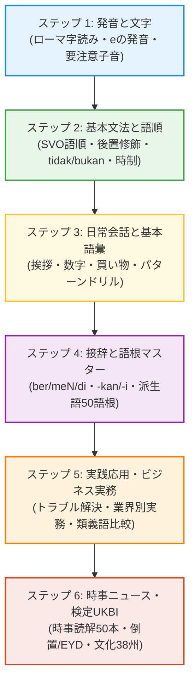

# インドネシア語学習ナレッジベース
### Bahasa Indonesia Knowledge Base untuk Pembelajar Jepang

ようこそ！このサイトは、日本人のためのインドネシア語（文字・発音・基本文法・接辞システム・語彙・日常会話・ビジネス・時事・検定対策・文化）を網羅した**全500記事の体系的オープンナレッジベース**です。

旅行や出張、現地生活、駐在、技能実習の受入・協働から、インドネシア語技能検定（INKEN）や国家検定UKBIの最上級突破まで、初心者からプロフェッショナルまでいつでも引ける実践的リファレンスを提供します。

全500記事の完全目録・ロードマップをお探しですか？

目的やレベルに合わせた最短ルートや、全記事のリンク一覧を掲載した総合サイトマップをご用意しています。

[:octicons-map-24: **総合サイトマップ・全コンテンツ目録を見る（500記事一覧）**](sitemap.md){ .md-button .md-button--primary }

---

## 📊 ナレッジベースの規模と特徴

-   :lucide-layers: **全 500 記事の圧倒的網羅性**

    ---

    基礎の発音・文法から、接辞50語根、ビジネス50実務、時事50本、検定50問、38州探訪まで、他に類を見ない学習ボリューム。

-   :lucide-spell-check: **日本人特化の徹底解説**

    ---

    `tidak` と `bukan` の違い、`meN-` の鼻音化法則、`ber-` と `meN-` の対比、`kan` と `i` の使役・受益など、日本人がつまずく難所を完全攻略。

-   :lucide-briefcase: **現場で使えるプロの生きた表現**

    ---

    単なる旅行会話にとどまらず、工場5S、ITアジャイル、保税区通関、労使交渉、契約書読解など、日系企業のビジネス実務に直結。

-   :lucide-award: **検定（INKEN）＆ UKBI 対策**

    ---

    倒置構文、EYD公的表記規則、公的文書読解、聴解メモ術など、独学が難しい中上級・最上級試験の攻略ノウハウを凝縮。

---

## 📚 主要セクション・カリキュラム案内

各セクションのカードをクリックすると、該当カテゴリーの解説や記事一覧へ直接アクセスできます。

-   :lucide-spell-check: **[文字と発音 (全8記事)](pronunciation/alphabet-vowels.md)**

    ---

    アルファベットの読み方、母音（eの2種類の発音）、注意すべき子音（c, r, ng, ny, kh など）、アクセントの基本を完全マスター。
    
    [:octicons-arrow-right-24: アルファベットと母音から学ぶ](pronunciation/alphabet-vowels.md)

-   :lucide-book-open: **[基本文法と構文 (全16記事)](grammar/word-order.md)**

    ---

    SVO基本語順、後置修飾、否定詞（`tidak` vs `bukan`）、疑問詞、人称代名詞、時制副詞、前置詞、受動態の基礎。
    
    [:octicons-arrow-right-24: 基本語順と後置修飾から学ぶ](grammar/word-order.md)

-   :lucide-puzzle: **[接辞システム完全攻略 (全16記事)](affixes/overview.md)**

    ---

    インドネシア語の醍醐味である接辞（meN-, di-, ber-, ter-, peN-, -kan, -i, ke-...-an）の法則と意味変化を徹底解剖。
    
    [:octicons-arrow-right-24: 接辞システム概要を見る](affixes/overview.md)

-   :lucide-git-branch: **[語根別派生語マスター図鑑 (全50記事)](derivations/root-tahu.md)**

    ---

    重要50語根（tahu, buat, jalan, ambil等）から広がる動詞・名詞・派生語を完全ネットワーク化。
    
    [:octicons-arrow-right-24: 語根 tahu の派生語を見る](derivations/root-tahu.md)

-   :lucide-library: **[語彙・テーマ別必須単語 (全15記事)](vocabulary/daily-nouns.md)**

    ---

    日常生活の必須単語、衣食住、動詞・形容詞各50選、家族、身体、料理、IT、天候、混同しやすい同義語一覧。
    
    [:octicons-arrow-right-24: 日常生活の基本名詞を見る](vocabulary/daily-nouns.md)

-   :lucide-scale: **[類義語・ニュアンス徹底比較事典 (全50記事)](synonyms/c01-tinggal-vs-diam.md)**

    ---

    辞書では同じ日本語になる似た単語（tinggal/diam, bantu/tolong, tahu/kenal等）の決定的な違いと使い分けを完全比較。
    
    [:octicons-arrow-right-24: tinggal vs diam を見る](synonyms/c01-tinggal-vs-diam.md)

-   :lucide-sparkles: **[スラング・口語・若者言葉 (全8記事)](slang-culture/bahasa-gaul-basics.md)**

    ---

    ジャカルタ口語（Bahasa Gaul）、文末詞（dong, sih, deh等）のニュアンス事典、SNS略語、最新流行語、ゴム時間文化。
    
    [:octicons-arrow-right-24: ジャカルタ口語の基礎を見る](slang-culture/bahasa-gaul-basics.md)

-   :lucide-message-circle: **[日常会話・シーン別表現 (全20記事)](conversation/greetings.md)**

    ---

    挨拶、自己紹介、数字・両替、レストラン・屋台、買い物・値段交渉、Grab配車、ホテル、病院、警察などの場面別会話。
    
    [:octicons-arrow-right-24: 基本の挨拶と自己紹介を見る](conversation/greetings.md)

-   :lucide-shield-alert: **[実践対話・トラブル解決ドリル (全50記事)](situations/ac-repair.md)**

    ---

    エアコン故障、断水、停電、事故、警察検問、病院ER、KITAS手続きなど、現地滞在中のリアルなトラブル対話シミュレーション。
    
    [:octicons-arrow-right-24: 修理依頼の対話を見る](situations/ac-repair.md)

-   :lucide-repeat: **[万能フレーズ型パターンドリル (全50記事)](patterns/requests-permissions.md)**

    ---

    【独立体系】単語を入れ替えるだけで無限に表現できる、依頼・理由・意見・感情・ビジネス連絡などの実用構文テンプレート50選。
    
    [:octicons-arrow-right-24: 依頼・許可・希望パターンを見る](patterns/requests-permissions.md)

-   :lucide-briefcase: **[ビジネス・実務特化インドネシア語 (全60記事)](business/office-greetings.md)**

    ---

    オフィス基本会話・メール（10記事）に加え、製造5S、IT開発、通関物流、人事労務、税務会計の専門実務（50記事）を完全網羅。
    
    [:octicons-arrow-right-24: ビジネスオフィス表現を見る](business/office-greetings.md)

-   :lucide-newspaper: **[長文・時事ニュース読解 (全60記事)](reading/daily-routine-jakarta.md)**

    ---

    エッセイ長文読解（10記事）と、新首都IKN、ニッケル下流化、中銀利上げ、EV産業など最新時事ニュース読解（50記事）。
    
    [:octicons-arrow-right-24: 長文読解トレーニングを見る](reading/daily-routine-jakarta.md)

-   :lucide-award: **[検定・UKBI突破演習 (全50記事)](exam-drills/u01-affixes-kan-vs-i-distinction.md)**

    ---

    検定C〜特A級・UKBI対策。接尾辞制約、倒置構文、EYD正書法、公的文書読解、聴解メモ術などの難問攻略ドリル。
    
    [:octicons-arrow-right-24: 接尾辞使い分け演習を見る](exam-drills/u01-affixes-kan-vs-i-distinction.md)

-   :lucide-map-pin: **[地理・38州・民族文化探訪 (全40記事)](geography-culture/g01-aceh-serambi-mekkah.md)**

    ---

    アチェからパプアまで全38州の風土、主要民族、伝統文化、歴史、名物料理を巡る壮大なカルチャーガイド。
    
    [:octicons-arrow-right-24: アチェ州探訪を見る](geography-culture/g01-aceh-serambi-mekkah.md)

---

## 🎯 体系的学習ロードマップ

各ステップの詳しい進め方と推奨記事は、[総合サイトマップ・全コンテンツ目録](sitemap.md)の「目的別・レベル別おすすめ学習ルート」をご参照ください。

---

## 💬 今日の実践フレーズ (Frasa Pilihan Hari Ini)

Selamat pagi! Apa kabar hari ini?

おはようございます！ 今日のご気分・調子はいかがですか？

Kabar baik, terima kasih banyak atas bantuannya kemarin.

元気です。昨日はサポートいただき、誠にありがとうございました。

---

## 💡 実践対話の例 (Contoh Percakapan Nyata)

  Taro
  Permisi Pak, bolehkah saya bertanya jalan menuju Stasiun MRT Bundaran HI?（すみません、ブンダランHI MRT駅へ行く道を教えていただけますか？）

  Warga
  Oh, lurus saja kira-kira seratus meter, stasiunnya ada di sebelah kiri jalan.（ああ、真っ直ぐ約100メートル進んでください。駅は道路の左側にありますよ。）

  Taro
  Baik, terima kasih banyak atas bantuannya!（分かりました、助かりました、ありがとうございます！）

---

## 🚀 自律運用の仕組み

本サイトは、AI組織（Director, Writer, Reviewer, Engineer, BOSS）が自律的にカリキュラムの選定・執筆・校正・ビルド検証・PDCA改善を回す仕組みによって構築・保守されています。
記事の追加・改善サイクルは `AGENTS.md` および `.agents/` の規約に基づいて継続的に運用されます。
全コンテンツの一覧は [総合サイトマップ](sitemap.md) からご覧いただけます。
