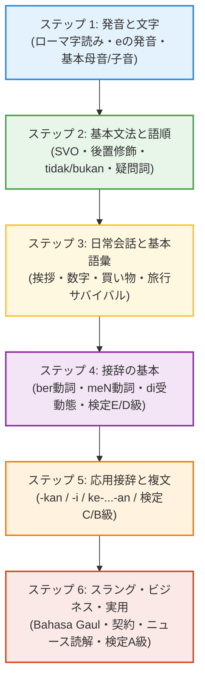

# インドネシア語学習ナレッジベース
### Bahasa Indonesia Knowledge Base untuk Pembelajar Jepang

ようこそ！このサイトは、日本人のためのインドネシア語（文字・発音・基本文法・接辞システム・日常会話・語彙・スラング・文化）を体系的に整理・学習するための**オープンナレッジベース**です。

出張や旅行、駐在、技能実習の受け入れ、語学検定（インドネシア語技能検定 / UKBI）の受験対策まで、初心者から中上級者までがいつでも素早く引けて学べるリファレンスを目指しています。

---

## 🌟 インドネシア語の魅力と特徴

インドネシア語は、日本人にとって**「世界で最も学びやすい言語の一つ」**と言われています。

1. **アルファベット表記**: 漢字や独自の文字を覚える必要がなく、英語と同じ26文字のアルファベットを使います。
2. **ほぼローマ字読み**: 基本的に文字通りそのまま発音すれば通じるため、発音の習得が非常に容易です。
3. **動詞の活用（時制変化）がない**: 過去形・未来形による語形変化（英語の go → went のような不規則変化）がなく、時制は副詞（`sudah` = すでに、`akan` = 〜する予定）を添えるだけです。
4. **性別・数による語形変化がない**: フランス語やロシア語のような男性名詞・女性名詞の区別がなく、複数形も単語を重ねるだけ（例: `anak` = 子ども → `anak-anak` = 子どもたち）です。
5. **奥深い接辞（インブハン）**: 語根に前や後ろからパーツを付けることで、名詞・動詞・形容詞を自由自在に派生させる美しい仕組みを持っています。

---

## 📚 ナレッジベースの構成

各セクションは、上部ナビゲーションまたは以下のカードからアクセスできます。

-   :lucide-spell-check: **文字と発音 (Huruf & Pelafalan)**

    ---

    アルファベットの読み方、母音（eの2種類の発音）、注意すべき子音（c, r, ng, ny, kh など）、アクセントの基本をマスターします。

-   :lucide-book-open: **基本文法 (Tata Bahasa Dasar)**

    ---

    SVOの基本語順、「名詞＋形容詞」の後置修飾、否定詞（`tidak` と `bukan` の使い分け）、疑問詞、人称代名詞、時制表現を学びます。

-   :lucide-puzzle: **接辞システム (Sistem Imbuhan)**

    ---

    インドネシア語最大の関門であり醍醐味である接辞（meN-, di-, ber-, ter-, peN-, -kan, -i, ke-...-an 等）の規則と意味変化を徹底解説します。

-   :lucide-message-circle: **日常会話・場面別表現 (Percakapan)**

    ---

    挨拶、自己紹介、買い物・値段交渉、レストランでの注文、タクシー・Grab移動、ホテル、緊急時のトラブル対応フレーズです。

-   :lucide-layers: **語彙・頻出単語 (Kosakata)**

    ---

    日常生活の必須単語、数字・時間・日付、感情・身体の表現、混同しやすい同義語の使い分けをジャンル別に収録します。

-   :lucide-sparkles: **スラング・口語・文化 (Bahasa Gaul & Budaya)**

    ---

    教科書には載っていないジャカルタの若者言葉（Bahasa Gaul）、チャット略語、インドネシアの習慣・宗教的マナー・ゴム時間（Jam Karet）文化を紹介します。

-   :lucide-award: **検定対策・読解 (Ujian Kemampuan)**

    ---

    日本国内の「インドネシア語技能検定」（E級〜A級・特A級）の出題傾向と対策、ニュースや短文の読解トレーニングです。

-   :lucide-wrench: **リソース・学習ガイド (Sumber & Panduan)**

    ---

    おすすめ辞書・学習アプリ・WEBサイトの紹介と、このナレッジベースを拡張・執筆するためのMarkdownテンプレート集です。

---

## 🎯 学習ロードマップ

---

## 💬 今日の基本フレーズ (Frasa Dasar)

{Selamat|スラマッ} {pagi|パギ}! {Apa|アパ} {kabar|カバール}?

スラマッ パギ！ アパ カバール？

おはようございます！ お元気ですか？

{Kabar|カバール} {baik|バイッ}, {terima|トゥリマ} {kasih|カシ}.

カバール バイッ、トゥリマ カシ。

元気です、ありがとうございます。

---

## 💡 会話例 (Contoh Percakapan)

  Taro
  {Permisi|プルミシ}, {berapa|ブラパ} {harganya|ハルガニャ} {ini|イニ}?（すみません、これはいくらですか？）

  Penjual
  {Ini|イニ} {dua|ドゥア} {puluh|プル} {ribu|リブ} {rupiah|ルピア}.（これは2万ルピアです。）

  Taro
  {Bisa|ビサ} {kurang|クラン} {sedikit|スディキッ}?（少し安くしてもらえますか？）

---

## 🚀 自律運用の仕組み

本サイトは、AI組織（Director, Writer, Reviewer, Engineer, BOSS）が自律的にカリキュラムの選定・執筆・校正・ビルド検証・PDCA改善を回す仕組みによって構築されています。
記事の追加・改善サイクルは `AGENTS.md` および `.agents/` の規約に基づいて継続的に運用されます。
