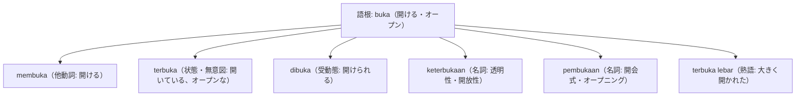

# 初級を終えたあなたへ！日本人学習者が「中級の壁」を突破する7つの処方箋

「基本単語も覚えたし、日常の挨拶や簡単な会話はできるようになった。でも、ネイティブ同士の速い会話になると全く聞き取れないし、新聞や長い文章になるとどこが主語で述語なのか分からなくなる……」

これは、真面目にインドネシア語を学習してきたほぼすべての日本人が直面する**「中級の壁（Plato Belajar）」**です。

インドネシア語は「世界一簡単な言語」と紹介されることがありますが、それはあくまで入門期の文法規則（格変化や動詞の活用がない）に限った話です。中級以降は、世界屈指の複雑さを誇る**「接辞システム（Imbuhan）」**と、標準語と口語の**「言語の二重構造（Diglossia）」**が立ちふさがります。

本記事では、全100記事の集大成として、中級の停滞期を突き破り、上級・ネイティブレベルへと飛翔するための「7つの処方箋」を提示します。

---

## 処方箋 1: 「語根」中心の派生語ネットワーク暗記法

初級期は「単語を1語ずつ個別に覚える」ことで対応できますが、中級期にその方法を続けると頭がパンクします。

中級以降は、**「1つの語根（Kata Dasar）から生まれるすべての派生語を蜘蛛の巣状にセットで覚える」**手法へと完全にシフトしてください。

語根の意味さえ掴んでいれば、未知の長い単語に出会っても「接辞の機能」から品詞とニュアンスを瞬時に逆算できるようになります。

---

## 処方箋 2: 接尾辞 -kan と -i の機能対立の徹底攻略

日本人学習者が最も苦手とし、検定C級・B級で合否を分けるのが **-kan** と **-i** の使い分けです。

| 接尾辞 | コア機能 | 代表例 | 構文のイメージ |
| :--- | :--- | :--- | :--- |
| **-kan** | **使役（〜させる）** / **受益（〜のためにする）** | mendekatkan（近づける）, membelikan（買ってあげる） | 対象（人・物）をどこかへ「動かす・移動させる」 |
| **-i** | **場所・対象への直接付与** / **反復** | mendekati（〜に近づく）, memukul-mukuli（殴り続ける） | 動作の対象が「不動の目的地・受け皿」として留まる |

この2つの対比（mendekatkan vs mendekati, mendudukkan vs menduduki）を例文カードで何度も比較反復することが、精緻な文法感覚を養う最短ルートです。

---

## 処方箋 3: 語幹受動態（一人称・二人称受動構文）の完全自動化

「受動態＝di-」と思い込んでいると、中級の文章は読めません。

インドネシア語では、行為者が一人称（saya/kami）や二人称（kamu/Anda）の場合、**di- を使わず「主語 ＋ 行為者 ＋ 語幹動詞」**という語幹受動態を作ります。

- 能動態: *Saya sudah membaca buku itu.*（私はその本をもう読みました。）
- 語幹受動態: **Buku itu sudah saya baca.**（その本は、私によってもう読まれました。）

この語幹受動構文は、客観的で洗練された文章や日常会話で能動態よりも頻繁に登場します。頭で考えずに口からスラスラ出るまで音読してください。

---

## 4. 処方箋 4: ニュース記事（Kompas）の速読と複文構造の分解

中級レベルに達したら、Kompas.com などの大手新聞記事を毎日1本精読しましょう。

新聞の文章は、関係詞 **yang**、従属接続詞（karena, sehingga, meskipun, bahwa）、周囲辞（peN-...-an, ke-...-an）が何重にも連なった長文構造をしています。

1. **まず文の主語（S）と述語（P）をマークする**
2. **関係代名詞 yang の修飾範囲をカッコ [ ] で括る**
3. **接続詞で文を前半と後半に切り分ける**

このスラッシュリーディング（構造分解）を1ヶ月続けると、長文に対する恐怖心が完全に消え去ります。

Pemerintah [yang baru saja dilantik] berjanji [bahwa mereka akan meningkatkan kesejahteraan masyarakat di daerah terpencil].

[就任したばかりの] 政府は、[僻地の住民の福祉を向上させると] 約束しました。

S: Pemerintah / P: berjanji / yang句とbahwa節の複文構造。

---

## 5. 処方箋 5〜7: 実践アウトプットとバイリンガル脳

- **処方箋 5: シャドーイング（音読）**:
  - 音声（YouTubeのニュースやポッドキャスト）の0.5秒後を追いかけて声に出すシャドーイングは、脳内の「音韻ループ」を鍛え、ネイティブの速いスピードへの耐性をつけます。
- **処方箋 6: オンラインレッスンの戦略的活用**:
  - フリートークで漫然とおしゃべりするのではなく、「今日は -kan の例文を10本作る」「このニュース記事についてディスカッションする」と学習者側からテーマを指定してレッスンに臨みましょう。
- **処方箋 7: 標準語（Baku）と口語（Gaul）の切り替え**:
  - どちらか一方に偏るのではなく、「ニュースやビジネスでは格調高い標準語」「カフェやSNSでは親近感あるGaul」を状況に応じて華麗にスイッチできるバイリンガル脳を目指しましょう。

---

## 6. おわりに: 100記事の旅を終えたあなたへ

文字と発音から始まり、文法、接辞、日常会話、ビジネス、語彙、スラング、そして文化・学習法に至る**全100記事**のカリキュラムを完走したあなたの手元には、すでに日本人向けインドネシア語学習の最高峰の知恵が揃っています。

インドネシア語には、**「Sedikit-sedikit, lama-lama menjadi bukit（少しずつでも、時間をかければやがて山となる / 塵も積もれば山となる）」**ということわざがあります。

今日学んだ1つのフレーズ、1つの単語を大切に使い続けてください。インドネシアの人々は、あなたの言葉と敬意を、満面の温かい笑顔で受け止めてくれるはずです。

*Selamat belajar dan sukses selalu untuk masa depan Anda!*（学習の成功と、あなたの素晴らしい未来を心より応援しています！）

---

## 7. 理解度チェッククイズ

Q1. 中級以降の語彙学習において、単語を1語ずつ丸暗記する代わりに採用すべき最も効率的な学習法は？

<strong>正解: 語根（Kata Dasar）を中心とした派生語ネットワーク暗記法</strong> 
解説: 1つの語根から派生する動詞・名詞・形容詞をセットで覚えることで、体系的かつ爆発的に語彙が増加します。

Q2. 行為者が一人称や二人称の場合に、di- を使わず「目的語 ＋ 行為者 ＋ 語幹動詞」で作られる受動構文を何と呼ぶ？

<strong>正解: 語幹受動態（または一人称・二人称受動構文）</strong> 
解説: 「Surat ini sudah saya baca（この手紙は私がもう読みました）」のように、洗練された客観文で極めて多用されます。

Q3. 「少しずつでも、時間をかければ山となる（塵も積もれば山となる）」を意味するインドネシアのことわざは？

<strong>正解: Sedikit-sedikit, lama-lama menjadi bukit</strong> 
解説: 地道な努力の継続が偉大な成果を生むことを説く、学習者への最高の座右の銘です。

