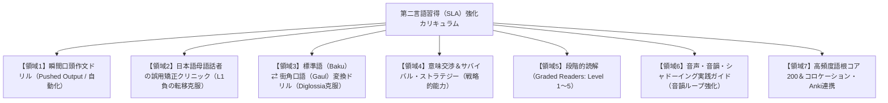

# 第二言語習得（SLA）観点によるインドネシア語学習ナレッジベース包括的レビュー＆拡充カリキュラムレポート

- **調査・分析**: AI組織 編集・企画部門（BOSS / Director / Reviewer 合同タスクフォース）
- **対象**: インドネシア語学習ナレッジベース（全1,000記事、24セクション）
- **基準理論**: 第二言語習得論（Second Language Acquisition: SLA）
  - 理解可能なインプット仮説（Krashen）
  - 言語形式への気づき（Focus on Form / Noticing, Long, Ellis, Schmidt）
  - アウトプット仮説・スキル習得理論（Swain, DeKeyser）
  - 母語転移・対照分析（Odlin, Lado）
  - メンタルレキシコンと語彙知識体系（Nation）
  - 社会言語学的能力・二重言語現象（Canale & Swain, Ferguson）
  - コミュニケーション・ストラテジー＆自律学習論（Oxford, Dörnyei）
- **日付**: 2026-10-19

---

## 1. エグゼクティブサマリー (Executive Summary)

本ナレッジベースは、全1,000記事に及ぶ膨大なリソースを誇り、発音から基本文法、接辞システム、語根別派生語（100語根）、類義語比較（100対）、業界別ビジネス（100分野）、時事読解（100本）、検定演習（100本）に至るまで、**日本語話者向けインドネシア語教材としては国内最高峰の語彙的・文法的な網羅性と記述の精緻さ**を達成している。

しかし、**第二言語習得（SLA）の現代的知見に照らし合わせた場合、本ナレッジベースは「受容的・宣言的知識（Declarative Knowledge: 理解できる・知っていること）」に大きく偏重しており、「手続き的知識（Procedural Knowledge: 無意識かつ即時に運用できること）」への自動化（Automatization）を促す仕掛けが構造的に不足**している。

### 本レビューの主要結論
1. **強み**: 
   - 語根（Kata Dasar）を中心とする形態素ネットワークの可視化が極めて優れており、メンタルレキシコン（心内辞書）の効率的な構築に直結している。
   - 類義語の語用論的比較（TPO、使用頻度、共起制限）の質が高く、ニュアンスの混同を防ぐ設計がなされている。
2. **課題（SLA的ボトルネック）**:
   - **音声インプットと音韻ループの未連携**: テキスト情報のみであり、調音・プロソディ・生きたリスニングの統合が弱い。
   - **プッシュド・アウトプット（Pushed Output）の欠落**: 選択肢クイズはあるが、日本語から瞬時に構文を生成する「瞬間作文・産出ドリル」が不足。
   - **日本語母語話者（JFL）特有の負の転移（干渉）への対処不足**: 日本語の発想（アスペクト、受動態、無生物主語、待遇表現）を直訳した「不自然なインドネシア語（Bahasa Indonesia rasa Jepang）」の体系的矯正プログラムがない。
   - **標準語（Baku）と口語（Gaul）の二重構造（Diglossia）コード変換訓練の欠如**: それぞれ独立して記述されているが、同一の事態を両形式で相互変換するブリッジ演習が不足。
   - **意味交渉（Negotiation for Meaning）ストラテジーの不足**: 会話が破綻しそうなときに発話を維持・修復する戦略的表現の体系化が未整備。

---

## 2. SLA理論に基づく詳細レビュー（7大領域の多角的分折）

### 2.1 理解可能なインプット（Comprehensible Input: $i + 1$, Krashen）
- **現状の評価**:
  - 時事ニュース読解（100記事）、長文読解（10記事）、民話文学（50記事）など、文脈化された豊かなインプットが極めて潤沢に提供されている。
- **SLA観点からの課題**:
  - **難易度勾配（Graded Readers）の不明瞭性**:
    記事ごとの想定語彙制限や文法レベル（CEFR A1〜C2 / UKBIランク）が厳密に段階化されておらず、学習者が自分の現在地（$i$）に最適な教材（$i + 1$）を自律的に選別しにくい。
  - **マルチモーダル（音声・プロソディ）の不在**:
    言語習得において、文字情報と聴覚情報（音韻表象）の同時活性化はワーキングメモリの負荷を減らす必須要素である。完全テキストメディアである本サイトにおいて、外部音源やTTS（音声合成）、シャドーイング指導との有機的な連携設計が欠落している。

### 2.2 言語形式への気づき（Focus on Form / FonF, Long & Ellis; Noticing, Schmidt）
- **現状の評価**:
  - 基本文法（16記事）および接辞システム（16記事）は論理的で分かりやすい。
- **SLA観点からの課題**:
  - **Focus on Forms（形式単独学習）への偏重**:
    文法解説が「規則の解説」として独立しており、長文読解や実践対話の中で「なぜ能動態 meN- ではなく語幹受動態が選ばれたのか」「なぜ di-kan ではなく di-i なのか」を文脈の中で能動的に発見・意識させる「インプット強化（Input Enhancement）」や「気づき（Noticing）タスク」が少ない。
  - 学習者が「意味の理解」だけに満足して形式の細部に注意を向けない現象（Semantic Processing over Syntactic Processing）をブレイクスルーする仕掛けが不足。

### 2.3 スキル習得理論とアウトプット仮説（Swain, DeKeyser, Anderson）
- **現状の評価**:
  - 各記事に「理解度チェッククイズ（2〜3問）」が配置されている。
- **SLA観点からの課題**:
  - **プッシュド・アウトプット（Pushed Output: 強いられた産出）の圧倒的不足**:
    現在のクイズは主に「正解の単語を選ぶ」「意味を確認する」受容的確認にとどまる。
  - スキル習得理論（Skill Acquisition Theory）において、宣言的知識（ルールを知っている）から手続き的知識（素早く使える）への移行には、**「文脈に即した形式の引き出し（Retrieval Practice）」と「反復的な構文組み立て（Proceduralization）」**が不可欠である。日本語の刺激から即座にインドネシア語の語順・接辞を組み立てる「瞬間口頭作文（Pattern Practice / Rapid Production Drill）」がカリキュラムに存在しない。

### 2.4 母語転移と対照言語学（Cross-Linguistic Transfer, Odlin）
- **現状の評価**:
  - `tidak vs bukan` や `ber- vs meN-` など、日本人が混同しやすい表面的な文法対立はカバーされている。
- **SLA観点からの課題**:
  - **日本語母語話者（JFL: Japanese as a Foreign Language）特有の深層的誤用の見落とし**:
    1. **アスペクトとテンスの混同**: 日本語の「〜した（タ形）」を機械的に `sudah / telah` と直訳し、文脈から明らかな状況でも過剰に標示してしまう。
    2. **受動態の過剰使用と被影響受動の混乱**: 日本語の「雨に降られた」「財布を盗まれた」という被害受動の発想を、インドネシア語の `ke-...-an`（不本意・被災）や `di-`（意志的行為の受動）とどう正しくマッピングするか。
    3. **無生物主語の回避**: 日本語話者は「このバスに乗ればジャカルタに着く」を無生物主語で言えず、「もしこのバスに乗ったら…」と回りくどく表現しがち。
    4. **授受表現の直訳**: 「〜てあげる / 〜てもらう / 〜てくれる」を `memberi` で直訳し、接尾辞 `-kan`（受益構文）を適切に使えない。
  - これらの「日本語の発想がもたらす不自然さ（L1 Interference）」に特化した矯正・診断コンテンツが存在しない。

### 2.5 語彙習得とメンタルレキシコン（Nation: Form, Meaning, Use）
- **現状の評価**:
  - 語根別派生語マスター図鑑（100記事）は、接辞と語根の組み合わせを体系化しており、世界的に見ても屈指の完成度。
- **SLA観点からの課題**:
  - **Use（語用論的制約・共起コロケーション）と頻度（Frequency）の不足**:
    単語の意味（Meaning）と形式（Form）は網羅されているが、「どの単語と自然にセットで使われるか（Collocation）」、「日常頻度が高い語根ベスト200はどれか」という頻度別優先順位づけが希薄。
  - **間隔反復（Spaced Retrieval / SRS）への支援**:
    学習者が学んだ単語を忘却曲線に抗って復習するための、Ankiデッキ連携フォーマットや要約インデックスが整備されていない。

### 2.6 社会言語学的能力と二重言語現象（Sociolinguistic Competence & Diglossia）
- **現状の評価**:
  - ジャカルタ口語（Bahasa Gaul）や地方方言の個別記事がある。
- **SLA観点からの課題**:
  - **標準語（Baku）と口語（Gaul）のコード切り替え（Code-Switching）ドリルが不在**:
    インドネシア語の最大の特徴は、公的な標準語と日常口語の文法・語彙の乖離（二重言語性: Diglossia）にある。初中級者が教科書で学んでも現地の日常会話に全く歯が立たない「挫折の壁」を打破するには、**「同じ意味の事態を、標準語（新聞・ビジネス）と日常口語（チャット・会話）の双方向で書き換える変換ドリル」**が極めて効果的であるが、現状は個別の解説にとどまっている。

### 2.7 コミュニケーション・ストラテジーと学習者オートノミー（Strategic Competence & Autonomy）
- **現状の評価**:
  - 日常会話・シチュエーション対話は120記事以上と極めて豊富。
- **SLA観点からの課題**:
  - **意味交渉（Negotiation for Meaning）スキルの欠如**:
    会話がスムーズに進むシナリオばかりが提示されており、「相手の言葉が聞き取れなかったとき」「単語をど忘れしたとき」「相手が早口すぎるとき」に発話を破綻させずに立て直す**修復ストラテジー（Confirmation Check, Clarification Request, Circumlocution: 迂回表現）**の専門記事がない。
  - **メタ認知ストラテジー（自己学習管理）の不足**:
    学習者が自分の学習進捗を客観的に評価し、AIチャットやオンラインレッスンをどう使って独学を最大化するかという「学習者オートノミー」の指南が不足。

---

## 3. レベル別（CEFR / UKBI / 検定）SLAギャップ分析表

| レベル | 目標言語運用能力 | 現状ナレッジベースのカバー度 | SLA観点から不足している決定的要素 |
| :--- | :--- | :--- | :--- |
| **A1〜A2**<br>(入門・初級 / 検定E〜D級) | 自己紹介、買い物、数字、平易な日常表現の理解と発話 | ★★★★☆<br>(文法・日常表現は十分) | ・DM（修飾後置）語順の瞬間自動化ドリル<br>・調音器官（舌・唇・声帯）の物理的発音ガイド<br>・日本語直訳癖の初期矯正 |
| **B1〜B2**<br>(中級・実務 / 検定C〜B級 / UKBI Madya) | 複文構造の理解、接辞の使い分け、仕事上の対話・交渉 | ★★★★★<br>(派生語・類義語・構文は最高水準) | ・接尾辞 `-kan vs -i` の瞬間産出トレーニング<br>・一人称・二人称語幹受動態の自動発話化<br>・標準語（Baku）と口語（Gaul）の双方向変換<br>・意味交渉ストラテジー |
| **C1〜C2**<br>(上級・専門 / 検定A級 / UKBI Unggul〜Istimewa) | 抽象概念の論述、学術・法務・文学の読解、即時通訳 | ★★★★☆<br>(時事・文学・法務は豊富) | ・高度なコロケーション（共起表現）マスター<br>・イディオム・ことわざ（Peribahasa）の談話内運用<br>・ニュアンスの微細な差別化（格調と論理展開） |

---

## 4. 追加すべきコンテンツ・カリキュラム体系（優先度順）

第二言語習得理論に基づき、本サイトを「単なる読書・辞書サイト」から「自動化と実用運用力を育む真のSLAプラットフォーム」へと昇華させるために、以下の**7大カテゴリー・全100記事の追加カリキュラム**を提案・策定する。



---

### 【領域1】瞬間口頭インドネシア語作文＆パターンプラクティス（Pushed Output / 25記事）
- **SLA的根拠**: スキル習得理論（DeKeyser）に基づく宣言的知識の手続き化。日本語のキュー（刺激）を受けて、1〜2秒以内に正しい語順と接辞で文を組み立てる反射神経を養う。
- **追加すべき記事例**:
  1. `output/rapid-drill-01-word-order.md`: 【瞬間作文】基本語順（SVO）と後置修飾の自動化 30本ノック
  2. `output/rapid-drill-02-tidak-bukan.md`: 【瞬間作文】tidak と bukan の反射的切り替え 30本ノック
  3. `output/rapid-drill-03-passive-stem.md`: 【瞬間作文】語幹受動態（Buku ini sudah saya baca）の即時発話 30本ノック
  4. `output/rapid-drill-04-kan-causative.md`: 【瞬間作文】接尾辞 -kan（使役・受益）の即座組み立て 30本ノック
  5. `output/rapid-drill-05-suffix-i.md`: 【瞬間作文】接尾辞 -i（場所・反復）の反射的産出 30本ノック
  6. `output/rapid-drill-06-circumfix-ke-an.md`: 【瞬間作文】周囲辞 ke-...-an（被災・過度）の瞬間作文 30本ノック
  7. `output/rapid-drill-07-conjunctions.md`: 【瞬間作文】接続詞（karena, sehingga, meskipun, bahwa）による複文展開
  8. `output/rapid-drill-08-politeness.md`: 【瞬間作文】丁寧な依頼・確認（tolong, mohon, silakan, sudilah）の使い分け

---

### 【領域2】日本人学習者の「不自然なインドネシア語」矯正クリニック（L1負の転移克服 / 20記事）
- **SLA的根拠**: 対照分析（Contrastive Analysis）と誤用分析（Error Analysis）。日本語の発想（テンス過剰、被害受動、授受動詞、無生物主語回避）をそのまま直訳した「文法的には間違っていないが極めて不自然なインドネシア語」を診断し、ネイティブの自然な発想（自然なコロケーション）へと再構築する。
- **追加すべき記事例**:
  1. `clinic/l1-error-01-tense-already.md`: 「〜した＝sudah」の罠！不要なアスペクト標示をやめる処方箋
  2. `clinic/l1-error-02-giving-receiving.md`: 「〜てあげる / もらう」を memberi で直訳しない！接尾辞 -kan と受動態の活用
  3. `clinic/l1-error-03-inanimate-subjects.md`: 無生物主語の壁！「この道を行けば駅に着く」をインドネシア語らしく表現する
  4. `clinic/l1-error-04-passive-overuse.md`: 日本語の「〜される」とインドネシア語の di- のズレ（受動態乱用の防止）
  5. `clinic/l1-error-05-aspect-preparatory.md`: 日本語の「〜ておく（準備）」はどう表現する？（siapkan, terlebih dahulu）
  6. `clinic/l1-error-06-aspect-regret.md`: 日本語の「〜てしまう（後悔・完了）」はどう表現する？（terlanjur, keburu, sampai-sampai）
  7. `clinic/l1-error-07-politeness-indirect.md`: 日本語の「遠回しな遠慮・断り」が現地で誤解される理由と、正しい文化的断り方

---

### 【領域3】標準語（Baku）⇄ 街角口語（Gaul）完全変換ドリル（Diglossia克服 / 15記事）
- **SLA的根拠**: 社会言語学的能力（Sociolinguistic Competence）および二重言語性（Diglossia）の橋渡し。同一の内容を、新聞・公式文書スタイル（Baku）と、SNS・カフェ・日常会話スタイル（Gaul）の双方で相互変換する訓練を通じて、TPOに応じたレジスターの適切な切り替え能力を養う。
- **追加すべき記事例**:
  1. `diglossia/transform-01-daily-actions.md`: 【変換ドリル】日常行動・会話（Baku ⇄ Gaul 相互変換30例）
  2. `diglossia/transform-02-emotions-reactions.md`: 【変換ドリル】感情・相槌・リアクション（Baku ⇄ Gaul 相互変換30例）
  3. `diglossia/transform-03-work-chat.md`: 【変換ドリル】社内チャット・同僚への連絡（フォーマルメール ⇄ WA口語）
  4. `diglossia/transform-04-news-to-gossip.md`: 【変換ドリル】時事ニュース記事を街角の噂話口調にリフレーズする
  5. `diglossia/transform-05-particles-mastery.md`: 【文末詞実践】sih, dong, deh, kok, kan を使った口語リライト特訓

---

### 【領域4】意味交渉＆サバイバル・コミュニケーション・ストラテジー（戦略的能力 / 10記事）
- **SLA的根拠**: インタラクション仮説（Long）における「意味交渉（Negotiation for Meaning）」。言語知識が不十分でも会話を破綻させず、相手とのやりとりを通じて理解を深め、インプットを引き出す戦略的運用力を身につける。
- **追加すべき記事例**:
  1. `strategies/negotiation-01-clarification.md`: 「聞き取れなかったとき」の切り返し（明確化要求: Maksudnya apa? Bisa ulangi?）
  2. `strategies/negotiation-02-confirmation.md`: 「自分の理解が合っているか確認する」表現（確認の求め: Apakah artinya...?）
  3. `strategies/negotiation-03-speed-control.md`: 「相手のマシンガントークを優雅に減速させる」フレーズ集
  4. `strategies/negotiation-04-circumlocution.md`: 「単語を忘れたときの迂回表現（あれ、あの丸い機械、〜するための物）」
  5. `strategies/negotiation-05-fillers-time.md`: 「沈黙を作らないための時間稼ぎフィラー（anu, begini, maksud saya...）」

---

### 【領域5】CEFR準拠 段階別リーディング（Graded Readers: Level 1〜5 / 15記事）
- **SLA的根拠**: Krashen の理解可能なインプット（$i+1$）と多読理論（Extensive Reading, Day & Bamford）。学習者が辞書を引かずに98%以上の単語を理解できるレベル別テキストを提供し、読解速度と文脈処理能力を飛躍させる。
- **追加すべき記事例**:
  1. `graded-reading/level-1-a1-daily.md`: 【Level 1: 基礎語彙300語】ジャカルタの大学生の一日（平易な短文と語根中心）
  2. `graded-reading/level-2-a2-travel.md`: 【Level 2: 基礎語彙600語】ジョグジャカルタへの夜行列車旅（基本接辞 ber-, meN-）
  3. `graded-reading/level-3-b1-society.md`: 【Level 3: 中級語彙1200語】屋台経済とキャッシュレス決済（複文と受動態）
  4. `graded-reading/level-4-b2-culture.md`: 【Level 4: 中上級語彙2000語】影絵芝居ワヤンと現代インドネシア人の死生観（派生語網羅）
  5. `graded-reading/level-5-c1-essay.md`: 【Level 5: 上級語彙3500語】新首都移転と環境保全のジレンマ（高度な論説文）

---

### 【領域6】音声・音韻・シャドーイング実践ガイド（音韻ループ強化 / 5記事）
- **SLA的根拠**: ワーキングメモリにおける音韻ループ（Phonological Loop, Baddeley）の強化。テキストサイトである本サイトの弱点を補い、学習者が外部メディアや最新AI音声ツールと組み合わせて耳と口を鍛えるための具体的実践ガイド。
- **追加すべき記事例**:
  1. `phonology/shadowing-methodology.md`: インドネシア語シャドーイング完全ガイド（段階的負荷調整と教材選び）
  2. `phonology/intonation-pitch-accent.md`: 「平坦ではない！」インドネシア語の句強勢（Sentential Accent）と文末イントネーション
  3. `phonology/connected-speech-linking.md`: ネイティブが音を脱落・連結させる規則（リエゾン・音節短縮の聞き取り）
  4. `phonology/ai-speech-practice.md`: スマホ・PCの最新AI音声ツール（ChatGPT音声会話・TTS）を使った独学スピーキング環境構築

---

### 【領域7】高頻度語根コア200＆コロケーション・Anki連携リソース（分散学習 / 10記事）
- **SLA的根拠**: Nation の語彙知識体系（Form, Meaning, Use）と分散反復（Spaced Retrieval Practice）。学習効果が最も高い頻出コア語根を抽出し、共起表現（コロケーション）とともに定着させる。
- **追加すべき記事例**:
  1. `lexicon/top-200-roots-frequency.md`: 【コーパス分析】インドネシア語最頻出コア語根200選と基本派生マップ
  2. `lexicon/business-collocations-100.md`: ビジネス実務で必須の定型コロケーション100連発
  3. `lexicon/news-media-collocations-100.md`: 新聞・報道をスラスラ読むための重要共起語100選
  4. `lexicon/anki-deck-guide.md`: 本サイトの語彙・例文をAnkiにインポートして生涯記憶化するガイド

---

## 5. PDCA改善計画と推奨実装ロードマップ

本レポートの提言をナレッジベースに反映させるため、以下の3段階での自律実装を推奨する。

```
[フェーズ1: 直近の最重要ギャップの埋め合わせ (即効性の高いSLAコンテンツ)]
  - 領域2: 日本人学習者の誤用矯正クリニック（clinic/）主要10記事
  - 領域4: 意味交渉＆サバイバル・ストラテジー（strategies/）主要5記事
  - 領域6: 音声・シャドーイング・AIスピーキング実践ガイド（phonology/）3記事

[フェーズ2: 手続き的知識への自動化と二重言語ブリッジ]
  - 領域1: 瞬間口頭作文パターンドリル（output/）主要15記事
  - 領域3: 標準語（Baku）⇄ 口語（Gaul）相互変換ドリル（diglossia/）主要10記事

[フェーズ3: 体系的読解力と長期定着のプラットフォーム化]
  - 領域5: 段階別リーディング（graded-reading/ Level 1〜5）
  - 領域7: コア語根頻度リスト＆コロケーション集（lexicon/）
```

---

## 6. まとめ

全1,000記事を完備した本インドネシア語学習ナレッジベースは、**知識の集積（Declarative Knowledge Base）としては類を見ない最高水準**に到達している。

今後は、本SLAレビューで明らかになった**「瞬間作文による自動化（Pushed Output）」「母語の負の転移の矯正」「二重言語の相互変換」「意味交渉ストラテジー」**を注入することにより、単に「読んで納得するサイト」を超えて、**「学習者の脳内に実践的運用回路を構築する、次世代の第二言語習得プラットフォーム」**へと劇的に進化を遂げることができる。

本レポートの知見を `pdca/` および組織全体のガイドラインに組み込み、今後のコンテンツ拡充に直ちに反映されたい。
